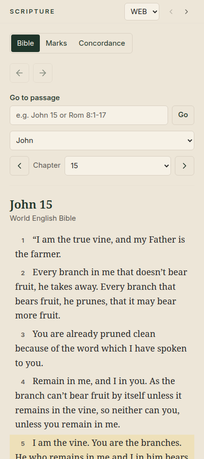

# 📖 2. Reading the Bible

[← Getting started](01-getting-started.md) · [Contents](README.md) · Next: [Highlights, notes and bookmarks →](03-highlights-notes-bookmarks.md)

---

The **Scripture** pane on the left is where you read.

  

## Going to a passage

There are three easy ways:

| Way | How |
|---|---|
| **Type it** | In **Go to passage**, type `John 15`, `Rom 8:1-17` or `Ps 23` and press **Enter** (or click **Go**). |
| **Choose it** | Pick a **book** from the list, then a **chapter**. |
| **Step through** | Use **‹** and **›** beside *Chapter* to go to the previous or next chapter. |

Short names work too: `Jn 3:16`, `1 Cor 13`, `Gen 1`.

When a passage is part of what you are studying, a thin coloured line runs
beside those verses, and the heading says *"showing John 15:1–11"*.

## Going back

The **← →** arrows near the top of the pane work like the back and forward
buttons in a web browser. They take you through the places you have just
read.

## Switching translations

Use the small **translation menu** at the top of the pane (it shows **WEB** in
the picture). Your place is kept: John 15 stays John 15.

> [!NOTE]
> Your highlights and notes belong to the **verse**, not to one translation.
> Switch translation and they are still there.

## Searching the Bible

1. In the app bar at the top, make sure the search menu says **Scripture**.
2. Type words, for example `living water`, and press **Enter**.
3. Click a result to open that verse.

Put words in quotation marks, like `"living water"`, to find that exact phrase.

> [!TIP]
> Want **every** place a single word appears, sorted by book? Use the
> [Concordance](07-concordance.md) instead.

---

[← Getting started](01-getting-started.md) · [Contents](README.md) · Next: [Highlights, notes and bookmarks →](03-highlights-notes-bookmarks.md)
