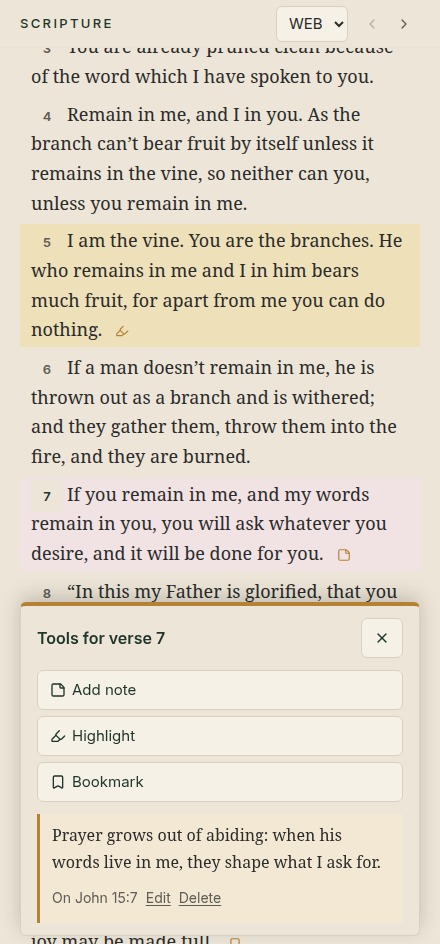
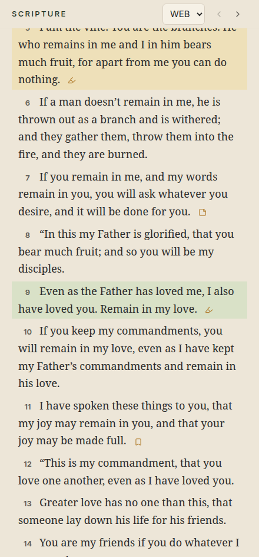
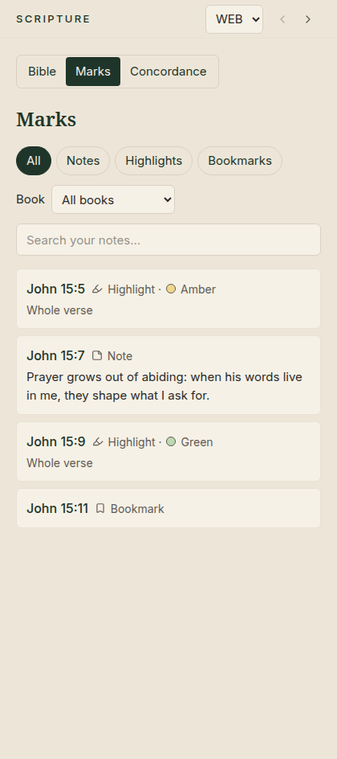

# 🖍️ 3. Highlights, notes and bookmarks

[← Reading the Bible](02-reading-the-bible.md) · [Contents](README.md) · Next: [Studies →](04-studies.md)

---

Mark the Bible the way you would with a pen, only neater, and nothing is ever
lost.

| Mark | What it is | Good for |
|---|---|---|
| 🖍️ **Highlight** | Colours a whole verse or just a few words | Key verses and phrases |
| 📝 **Note** | Your own words attached to a verse or phrase | Thoughts, cross-references, prayer points |
| 🔖 **Bookmark** | A quick marker on a verse | Places to come back to |

## Marking a whole verse

1. Click the small **verse number** in front of a verse.
2. The **Tools for verse …** panel opens at the bottom of the pane.
3. Choose **Add note**, **Highlight** (then pick a colour) or **Bookmark**.

  

The panel also shows the marks that are already there. In the picture, verse 7
already has a note, which you can **edit** or **delete**.

Press **Esc** or click **✕** to close the panel.

## Marking just a few words

1. Select the words with your mouse, as you would in a document.
2. A small bar appears at the bottom of the pane: choose **Highlight** or
   **Add note**.

## The five highlight colours

**Amber, green, blue, rose and grey.** No colour has a fixed meaning. Use them
in whatever way helps you.

  

A small symbol after a verse shows that it has a note, a bookmark or a
highlight. Click it to see them.

## Finding your marks again: *Marks*

Click **Marks** at the top of the Scripture pane to see everything you have
marked, in Bible order.

  

- Filter by **Notes**, **Highlights** or **Bookmarks**, or by **book**.
- **Search your notes** by typing a word.
- Click any mark to jump to that verse.

> [!NOTE]
> Marks stay with the verse in **every** translation. If a highlight is on a
> few words that a different translation words differently, Abiding Word says
> *"Not shown in this wording"*. It does not guess.

---

[← Reading the Bible](02-reading-the-bible.md) · [Contents](README.md) · Next: [Studies →](04-studies.md)
