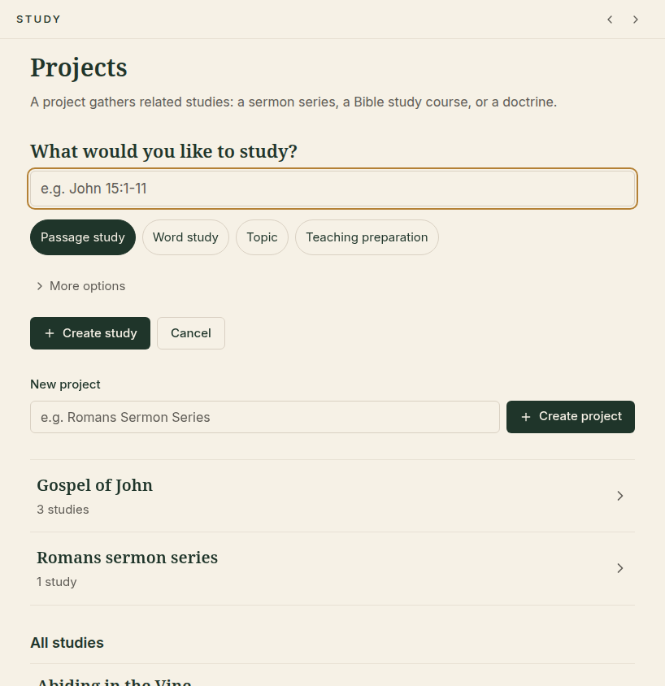
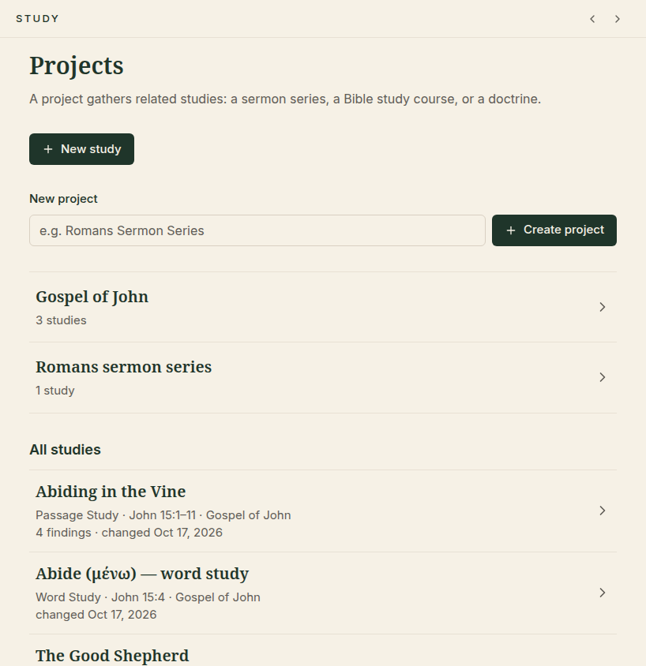
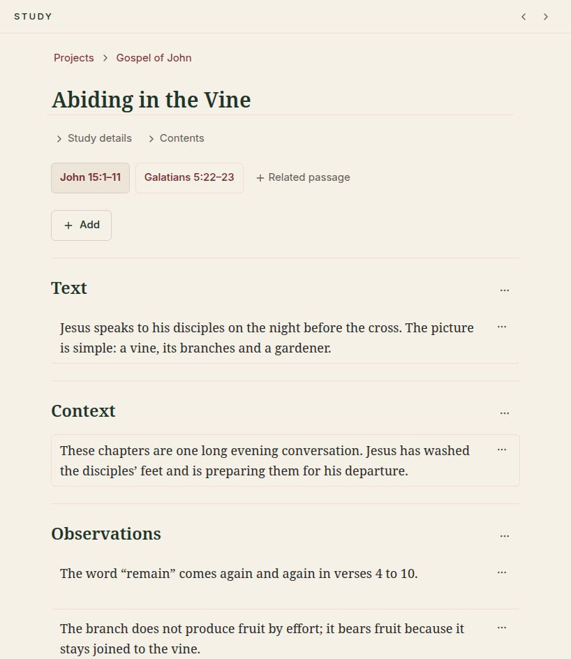
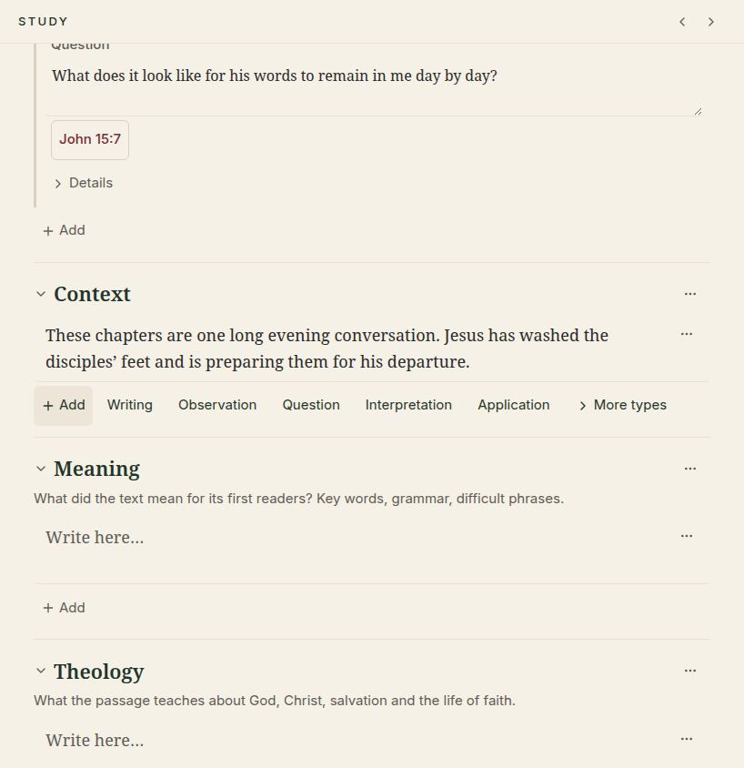
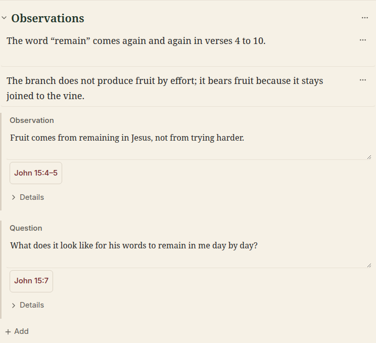

# ✍️ 4. Studies

[← Highlights, notes and bookmarks](03-highlights-notes-bookmarks.md) · [Contents](README.md) · Next: [Your library →](05-library.md)

---

A **study** is where your understanding grows: what you notice in the text,
the questions you ask, what it means and how to teach it. Each study is about
a passage, a word or a topic, and you write it in the middle pane.

## Starting a study

  

1. Click **New study** (or use the form you see on the start page).
2. Type what you want to study: a passage (`John 15:1-11`), a word (`abide`) or
   a topic (`prayer`).
3. Choose the kind of study:

   | Kind | Use it to… |
   |---|---|
   | **Passage study** | Work through a passage carefully: text, context, observations, meaning, application, teaching |
   | **Word study** | Follow one word through the Bible |
   | **Topic** | Gather what the Bible says about a theme |
   | **Teaching preparation** | Prepare a sermon, lesson or talk |

   Under **More options** you find more kinds (biblical theology, systematic
   theology, your own), the template to start from and the project to put it in.
4. Click **Create study**.

Each kind starts from a ready-made **template**: a set of headed sections with
a short hint in each. You can change the sections in any study, and make your
own templates in Settings.

## Projects: keeping studies together

A **project** groups studies that belong together, for example a sermon series,
a Bible study course or a book of the Bible.

  

Type a name under **New project** and click **Create project**. You don't have
to use projects. Until you do, all studies simply sit together.

## Inside a study

  

From top to bottom:

| Part | What it is |
|---|---|
| **Projects › Gospel of John** | Where the study lives; click to go back |
| **Title** | Click it to rename the study |
| **Study details** | The study's purpose, its status (*active, paused, completed, archived*), a short overview, links to related studies, and **Duplicate…** to copy the study |
| **Contents** | A clickable list of the study's sections, handy in long studies |
| **Passage buttons** | The main passage (darker) and related passages. Click one to open it on the left. **+ Related passage** adds another. |
| **+ Add** | Adds a note, a section or a block of text |
| **Sections** | *Text, Context, Observations…* Write straight into them. The **…** button on a section or paragraph lets you move, rename or delete it. |

Everything is **saved automatically** as you type.

> [!TIP]
> When you write a Bible reference in your study, like *John 3:16*, Abiding
> Word recognises it. It appears under **Passages mentioned**, and one click
> opens it in the Bible.

## Study notes: capturing what you discover

Besides your flowing text, a study collects short **notes**, each with a
**kind**: an observation, a question, an application and so on. They help you
see at a glance what you have learned.

  

1. Click **+ Add**, then **Note**.
2. Choose the kind. **Observation**, **Interpretation**, **Application** and
   **Question** are shown first. **More types** offers *Quotation, Doctrine,
   Illustration, Teaching idea, Unresolved issue* and *Conclusion*.
3. Write your note. Under **Options** you can put it in a section and link it
   to the passage you are reading.
4. Press **Ctrl + Enter** (or click Save).

  

Each note shows its kind, its section and its passage. Open **Details** to add
tags or to **cite a book from your library** (see
[Your library](05-library.md#citing-a-book-in-a-study-note)).

While reading a book you can also **add what you read straight into your
study**: select the words and choose **Add to Study**. See
[Using a book in your study](05-library.md#using-a-book-in-your-study).

## Finding a study again

- The start page lists **All studies**, newest first.
- In the app bar, switch the search menu to **Studies** and type a word to
  search everything you have written.

---

[← Highlights, notes and bookmarks](03-highlights-notes-bookmarks.md) · [Contents](README.md) · Next: [Your library →](05-library.md)
