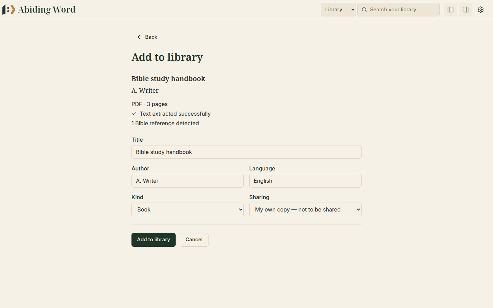
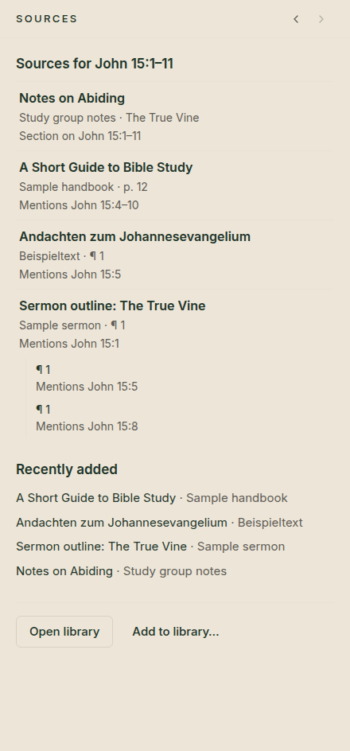
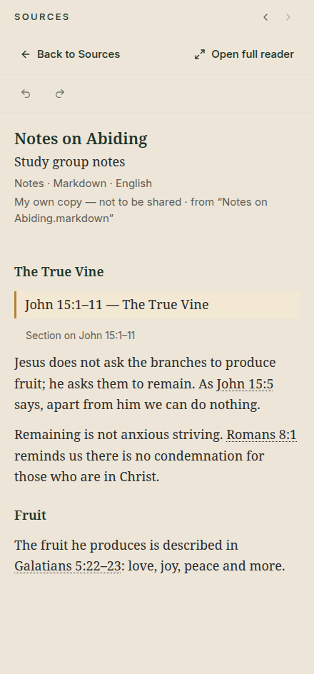
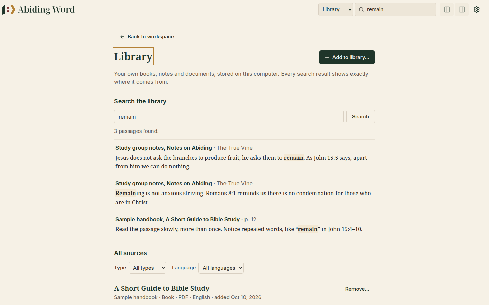

# 📚 5. Your library

[← Studies](04-studies.md) · [Contents](README.md) · Next: [Bible references in your books →](06-bible-references.md)

---

Your **library** holds your own books, articles, sermon notes and documents.
Abiding Word reads them, notices every Bible passage they mention, and shows
the right ones beside the passage you are studying.

> [!NOTE]
> **Private by default.** Your library stays on your computer. Abiding Word
> keeps its own copy of each file and **never changes your original**.

## What you can add

| File | Notes |
|---|---|
| **PDF** | Books and articles with real text (most PDFs). *Scanned PDFs* (photos of pages) can't be read yet. |
| **EPUB** | E-books |
| **Word** (`.docx`) | Documents, sermon manuscripts |
| **Markdown** (`.md`) and **text** (`.txt`) | Plain notes |

## Adding a book or document

1. Click **Add to library…** (at the bottom of the Sources pane, or on the
   Library page).
2. Click **Choose a file…** and pick the file.
3. Abiding Word reads it and shows a short summary first:

  

4. Check the **title**, **author** and **language**. The language matters:
   it decides how Bible references are read (a German book writes
   *Joh 3,16*, an English one *John 3:16*).
5. Choose the **kind** (book, article, notes, sermon, lecture, document) and
   whether it may be shared. *My own copy — not to be shared* is the safe
   choice for books you bought.
6. Click **Add to library**.

## Books for the passage you are reading

The **Sources** pane on the right always lists the books in your library that
deal with the passage open on the left, and says **why**:

  

| It says | It means |
|---|---|
| **Mentions John 15:5** | The book quotes or refers to that verse |
| **Section on John 15:1–11** | A heading in the book names the passage, so the whole section below it is about it |
| **p. 12** or **¶ 1** | Where in the book: page 12, or the first paragraph |

Books whose headings are about your passage come first. Click a book to read
it right there. Click the small extra lines to jump to other places in the
same book.

> [!NOTE]
> Abiding Word only lists what a book **actually says**. It does not guess
> what "might be related".

## Reading a book

  

- **Back to Sources** returns to the list.
- **Open full reader** gives the book the whole window. Your place is kept.
- The **↶ ↷** arrows go back and forward through the places you visited in
  the book.
- **Contents** (for books that have one) jumps to a chapter.
- Underlined Bible references can be opened in the Bible. See
  [Bible references in your books](06-bible-references.md).

### Reading or Original?

PDF, EPUB and Word files have a **Reading | Original** switch:

| View | What you see | Best for |
|---|---|---|
| **Reading** | The text, cleanly laid out, with clickable Bible references | Reading and studying |
| **Original** | The real pages, exactly as the file looks: pictures, columns, footnotes | Checking the original layout |

> [!NOTE]
> In the **Original** view of a **PDF**, Bible references can't be clicked
> yet. Use **Reading** for that. Making PDF pages interactive is planned for a
> later version.

## Searching your library

1. In the app bar, switch the search menu to **Library**.
2. Type a word and press **Enter**.

  

Every result says exactly where it comes from: the book, the section or page.
Click a result to open the book at that place.

## Citing a book in a study note

In a [study note](04-studies.md#study-notes-capturing-what-you-discover), open
**Details** and search your library for the passage you want to cite, then
click **Cite**. The citation stays readable even if you later remove the book
from your library.

## Removing a book

On the Library page, click **Remove…** beside the book. Citations in your
studies keep the title and author, so your notes still make sense.

---

[← Studies](04-studies.md) · [Contents](README.md) · Next: [Bible references in your books →](06-bible-references.md)
