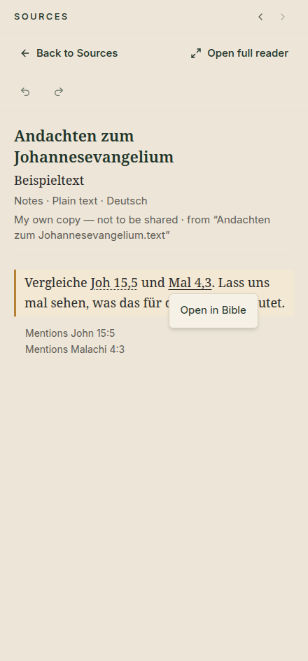
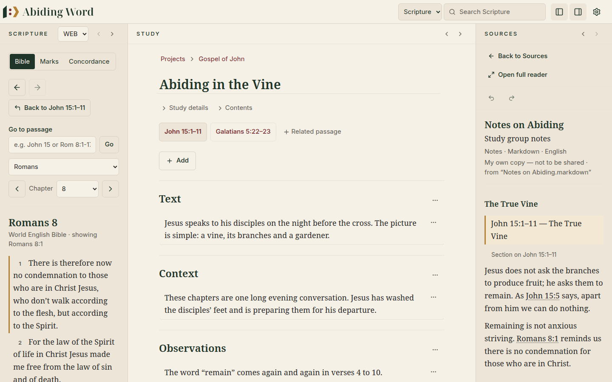

# 🔗 6. Bible references in your books

[← Your library](05-library.md) · [Contents](README.md) · Next: [Concordance →](07-concordance.md)

---

When a book in your library mentions a Bible passage, such as *Romans 8:1* or
*Joh 15,5*, you can open it in the Bible with one click, and come straight
back to your study afterwards.

## Opening a reference

1. In a book, Bible references are **underlined**.
2. Click one. A small menu appears.
3. Click **Open in Bible**.

  

The Scripture pane on the left now shows that passage.

## Finding your way back

Opening a reference never changes what your study is about. Abiding Word
remembers where you came from:

  

- **Back to John 15:1–11** (the main passage of your open study) takes you
  straight back to it.
- The **← →** arrows step back and forward through every passage you visited.

## Every language reads its own way

Every language below is understood in **every** book, so a German sermon
that quotes *John 3:16* or *요한복음 3장 16절* links them too. The language you
choose for a book decides which way of writing counts first when two
languages disagree, and how numbers without a book name (*15,4* or *15:4*,
*V. 5* or *v. 5*) are read:

| Book language | Written as | Opens |
|---|---|---|
| English | John 3:16 · Rom 8:1–4 | John 3:16 · Romans 8:1–4 |
| Deutsch | Joh 3,16 · Röm 8,1–4 · Mal 4,3 | John 3:16 · Romans 8:1–4 · Malachi 4:3 |
| 한국어 | 요한복음 3장 16절 | John 3:16 |
| Français | Jean 3,16 | John 3:16 |
| Español | Juan 3:16 | John 3:16 |
| Português | João 3:16 | John 3:16 |

> [!TIP]
> **Careful with everyday words.** Some book abbreviations are also ordinary
> words. The German *"mal"* (as in *"mal sehen"*) is not taken for Malachi.
> Abiding Word only links *Mal* when it is written with a capital M **and**
> a verse, like *Mal 4,3*. That is why, in the picture above, *"mal sehen"* is
> not underlined.

## Typing a passage in any language

Wherever you type a passage — the Bible's **Go to passage**, a study's
passages, a teaching's passages, a presentation and the Presenter View's
**Bible passage** — you can write it in any of **100 languages**, in the
alphabet of that language, whatever language Abiding Word itself is in:

| You type | Opens |
|---|---|
| John 15:5 · Joh 15,5 · Johannes 15,5 | John 15:5 |
| Jean 15,5 · Juan 15:5 · João 15:5 · Giovanni 15,5 | John 15:5 |
| 요한복음 15장 5절 · 约翰福音 15:5 · 約翰福音15章5節 · ヨハネによる福音書 15:5 | John 15:5 |
| Иоанна 15:5 · Κατά Ιωάννην 15,5 · يوحنا ١٥:٥ · יוחנן 15:5 · यूहन्ना १५:५ | John 15:5 |
| 1 Kor 13,4-7 · 1 Corinthians 13:4-7 · 哥林多前书 13:4-7 | 1 Corinthians 13:4–7 |

Numbers may be written with the digits of the language (١٥, १५, ১৫, ๑๕ …),
chapter and verse with `:`, `,` or `.`, and a book name alone opens its first
chapter.

**When an abbreviation means different books in different languages**,
Abiding Word decides in this order:

1. **The language of the Bible you are reading** (in a presentation, the
   presentation's Bible). It is taken from the Bible's own language
   information, never guessed from its name; a Bible without that
   information is simply skipped here.
2. **The language Abiding Word is in.**
3. **The common reading:** when the other languages agree (or most of the
   hand-checked ones do), that passage.
4. **Otherwise it asks** instead of guessing.

*Jn 3:5* is Jonah in Portuguese but John in English, French and Spanish. So
with a Portuguese Bible it opens Jonah 3:5 even if Abiding Word is in
English; with an English Bible it opens John 3:5 even if Abiding Word is in
Portuguese; with a German Bible and Abiding Word in German (German writes
*Joh*) the common reading, John 3:5, is used. *Hb 3:5* is Habakkuk in English
and Hebrews in Portuguese, and no other language settles it, so with
a German Bible and German interface it asks: *“Hb 3:5” could mean Habakkuk
3:5 / Hebrews 3:5*. English is not a hidden tie-breaker. (*Jn 15:5* is
always John: Jonah has four chapters.) Names you would mean otherwise are
never taken from another language: *Sam 3:5* is not read as some language's
Psalms, and *Jud 3:5* says Jude has one chapter.

The 100 languages are listed in the technical notes
([reference language packs](../reference-language-packs.md)). Underlined
references inside your books are read more carefully than what you type: a
book is read in the six languages below plus its own language.

## References without a book name

Sermons and commentaries often name the book once and then write only the
numbers: *John 15:1–11* in the title, then *15:4*, *15:5–6* or *v. 4* in the
text. Abiding Word links these too, **but only when it is clear which book is
meant**:

- after a reference in a list: *John 15:4; 15:7; 16:1*;
- in a section whose heading names the passage (*John 15:1–11*): *15:4*,
  *v. 4*, *vv. 7–8*, *verse 5*;
- shortly after a reference in the text just before;
- anywhere in a **sermon** or **lecture** whose title names one passage
  (choose *Sermon* or *Lecture* as the kind when you add it).

When two different books are in view, or none, the numbers stay plain text.
Times, prices and decimals (*10:30*, *1:30 pm*, *2,5 km*, *3.14*) are never
taken for verses. German books use *15,4* and *V. 4*, Korean *15장 4절* and
*4절*, as each language writes them.

## Where references work

| Where | Clickable references? |
|---|---|
| **Reading** view (every kind of file) | ✅ Yes |
| **Original** view of EPUB and Word files | ✅ Yes |
| **Original** view of a PDF | ✅ Yes (new; not in page headers and footers, sideways or right-to-left text, or scanned pages) |

---

[← Your library](05-library.md) · [Contents](README.md) · Next: [Concordance →](07-concordance.md)
