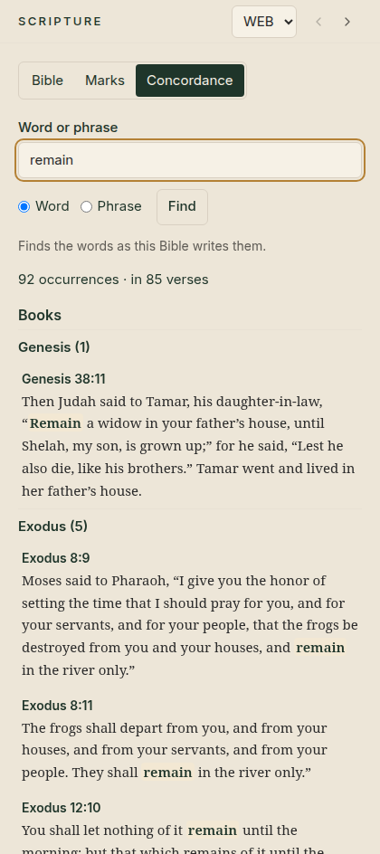
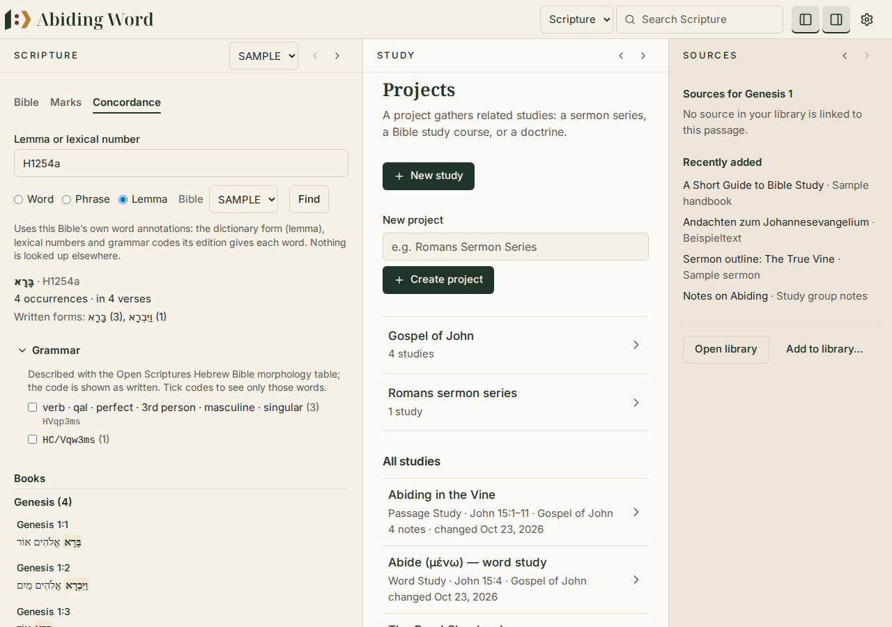
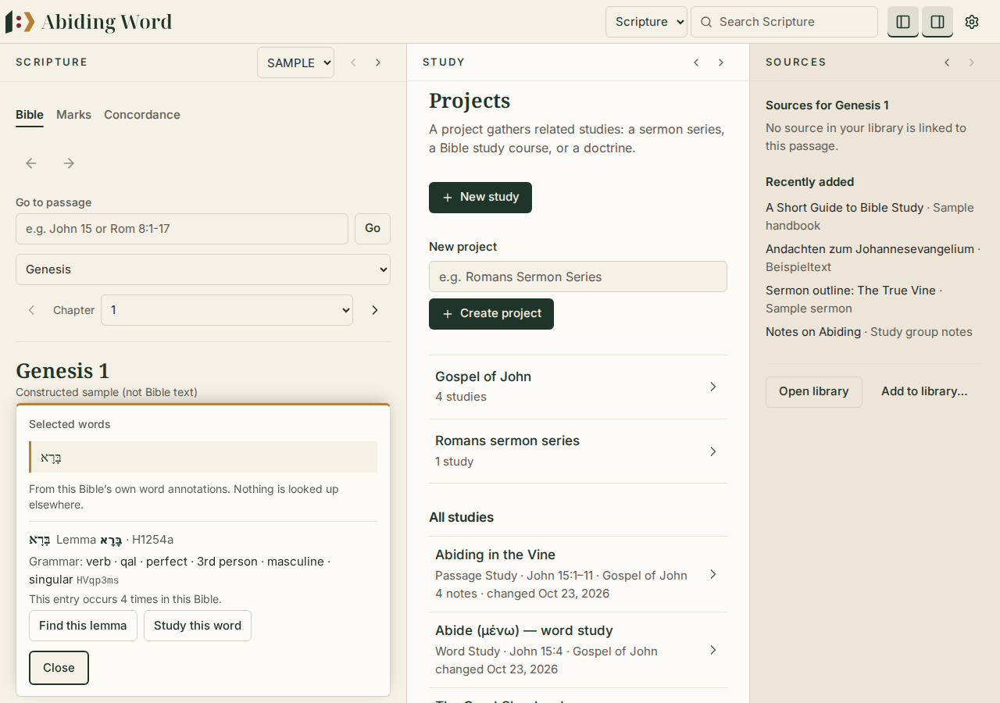

# 🔎 7. Concordance

[← Bible references in your books](06-bible-references.md) · [Contents](README.md) · Next: [Settings, updates and backups →](08-settings-updates-backups.md)

---

A **concordance** shows **every place a word appears** in a Bible: how often,
in which books and in which verses. It is the classic tool for word studies.

## Finding every occurrence of a word

1. Click **Concordance** at the top of the Scripture pane.
2. Type a word, for example `remain`.
3. Keep **Word** selected (or choose **Phrase** for several words in a row)
   and click **Find**.

  

You see:

- **how many times** the word occurs, and in how many verses;
- the results **grouped by book**, in Bible order;
- each verse in full, with the word in **bold**.

Click a verse to open it in the Bible.

> [!NOTE]
> The concordance finds words **exactly as this Bible writes them**. In the
> World English Bible, Jesus says "remain in me", so searching for `abide`
> finds nothing there, while `remain` finds 92 places. Switch translation at
> the top of the pane to search another Bible.

## From a word study

In a **Word study**, the button **Find occurrences** opens the concordance for
the study's word, in the Bible chosen for that study. When that Bible is
annotated, the study's information also has a **Lexical number** and a
**Find this lemma** button, which looks up exactly that number (or the word,
if no number is given). For a Bible without annotations it says that lemma
search is not available there.

## Greek and Hebrew Bibles

If you add a Greek or Hebrew Bible, the concordance makes searching easier:

| Bible | You can type… |
|---|---|
| **Greek** | without accents and breathings: `λογος` finds λόγος |
| **Hebrew** | without vowel points: `דבר` finds the word however it is pointed |
| **English, German and other languages** | the word as it is spelled. Capital letters don't matter, accents do (`Röm` and `Rom` are different). |

> [!NOTE]
> **Word** and **Phrase** look for words **as written**. To find every form of
> a word together (for example *λόγος* and *λόγῳ*), use **Lemma** with a Bible
> whose edition marks each word with its dictionary form (below).

## Searching by lemma (annotated Bibles)

Some Bible editions — usually Hebrew and Greek ones for study — mark every
word with its **lemma** (dictionary form), a **lexical number** (such as
Strong's *H1254*) and a **grammar code**. When you add such a Bible, the
review screen says so ("Word annotations: …"). Abiding Word then offers a
third choice in the concordance, **Lemma**. It appears only for Bibles that
have these annotations.

1. Choose **Lemma**, type a lemma (accents and vowel points don't matter) or
   a lexical number, and click **Find**.
2. If the same dictionary form stands for **different words** (they have
   different lexical numbers), you are shown each one with how often it
   occurs and how it is written. Choose one.
3. You see how often it occurs, in how many verses, every **written form**,
   and the verses by book with each occurrence marked.
4. Open **Grammar** to see the grammar codes of these occurrences, with
   counts. Tick one or more to see only those words; **Show all forms** undoes
   it.

  

> [!IMPORTANT]
> Everything here comes from **the Bible's own annotations**. Abiding Word
> looks nothing up elsewhere and invents nothing. Grammar codes of the Open
> Scriptures Hebrew Bible scheme are described in words ("verb · qal · perfect
> · 3rd person…"); codes of any other scheme are shown **as written**, because
> a wrong description would be worse than none. Bibles that only carry
> Strong's numbers (such as the included English, French, German and Spanish
> ones) are not used for lemma search.

## Word details in the Bible

In an annotated Bible, select one or more words. Next to **Add note** and
**Highlight** you'll see **Word details** (only when the words you selected
are annotated). It shows, for each word, its lemma and lexical number, its
grammar, and how often that entry occurs in this Bible. From there:

- **Find this lemma** opens the concordance on it;
- **Study this word** puts it into the Word Study that is open (if that study
  already studies another word, you are asked first).

  

---

[← Bible references in your books](06-bible-references.md) · [Contents](README.md) · Next: [Settings, updates and backups →](08-settings-updates-backups.md)
