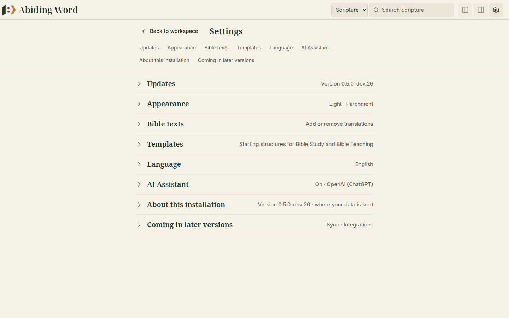
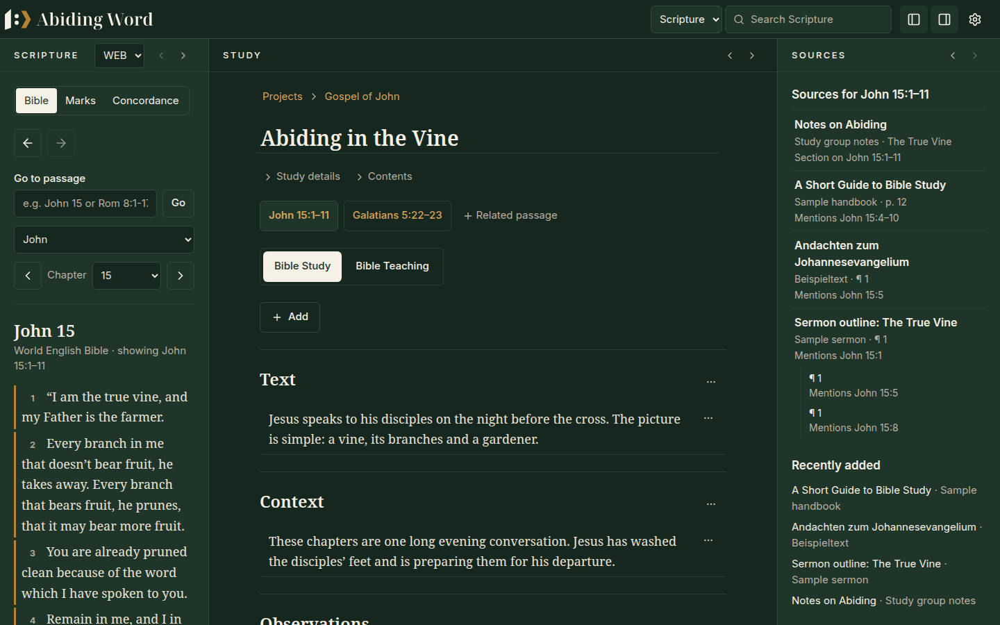
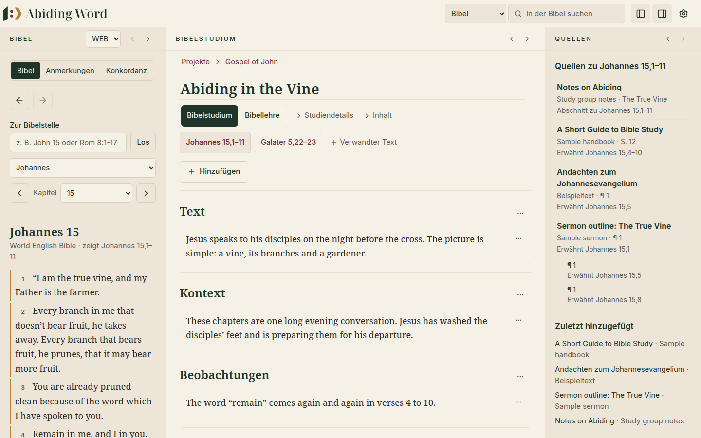
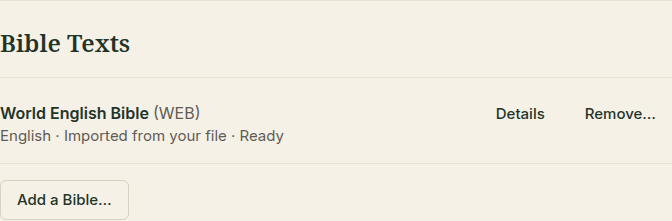
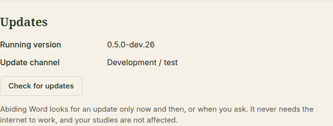

# ⚙️ 8. Settings, updates and backups

[← Concordance](07-concordance.md) · [Contents](README.md) · Next: [Questions and word list →](09-questions-and-word-list.md)

---

Click the **gear** ⚙️ at the top right to open **Settings**. **Back to
workspace** takes you back.

<p align="center">
  
</p>

## Appearance

| Theme | Looks like |
|---|---|
| **Light** | Warm ivory, for daytime study |
| **Dark** | Deep forest green, easier in low light |
| **Match my computer** | Follows your Windows setting |

<p align="center">
  
</p>

**Workspace layout → Reset layout** puts the three panes back in their usual
order and size. Your studies and library are not touched.

## Language

Choose the language of menus and buttons: **English, Deutsch, 한국어,
Français, Español or Português**. The change is immediate. Your studies,
notes and Bibles stay exactly as they are.

<p align="center">
  
</p>

## Bible Texts

<p align="center">
  
</p>

- **Add a Bible…** adds one of the free Bibles included with Abiding Word
  (English, German, Korean, French, Spanish, Portuguese) or a Bible file you own (see
  [Getting started](01-getting-started.md#add-a-bible)).
- **Details** shows a Bible's publisher, licence and contents.
- **Remove…** removes a Bible. Your notes and highlights are kept with their
  verses.

## Study Templates

Templates are the ready-made section lists a new study starts with. The
built-in ones can't be changed, but you can **duplicate** one and adjust the
copy: rename sections, add hints, change the order.

## Assistant

The assistant helps when you [prepare to teach](10-teaching.md). It is
**off** until you tick **Use the assistant**.

1. **Service:** choose one. *OpenAI*, *Anthropic (Claude)* and *Google Gemini*
   run on the internet and need a **key** from that company. *Ollama* and
   *LM Studio* run **on your own computer** (install them first), so your text
   does not leave it, and need no key.
2. **Model:** a suggested name is filled in; change it if the service's
   website tells you another.
3. **Key:** paste it and click **Keep key**. It is kept in your computer's own
   password store (on Windows: the *Credential Manager*), never in your
   studies, and is not shown again. **Remove key** deletes it.
4. **Checking real stories** (optional): real stories are only offered when a
   search service finds them. Choose *Brave Search* (needs its own key) or a
   *SearXNG* address you trust. Without one, the assistant says it cannot
   check real stories.
5. **Images:** finding freely licensed images on Wikimedia Commons is on (only
   search words are sent). **Allow making images** works with OpenAI only;
   such images are always marked as made by the assistant.
6. **Your theological tradition** (optional): in your own words, if you want
   the assistant to respect it. Left empty, it assumes no position and says
   where Christians read a passage differently.
7. Click **Save**, then **Check the connection**.

## Updates

<p align="center">
  
</p>

Every now and then, Abiding Word quietly checks whether a newer test version
exists. If there is one, a slim notice appears under the app bar:

> *An update is available: version …* **Update now** · **Later**

- **Update now** downloads it. The installer closes Abiding Word, installs
  the new version and starts it again.
- **Later** hides the notice for that version.
- **Settings → Updates → Check for updates** looks straight away.

> [!NOTE]
> Abiding Word **never needs the internet** to work. Without a connection,
> there is simply no update notice. Updates don't touch your studies or
> library.

## About this installation

This shows the version and the **folder where your work is kept**. You need
it for backups.

## Backups

Your studies, notes, library and Bibles all live in **one folder**:

```
C:\Users\<your name>\AppData\Roaming\Abiding Word
```

**To make a backup:**

1. **Close Abiding Word.**
2. Copy the whole **Abiding Word** folder to a USB stick, an external drive
   or a cloud folder of your choice.

**To restore it**, close Abiding Word and copy the folder back to the same
place.

> [!TIP]
> Abiding Word also protects you automatically. Before an update changes how
> your data is stored, it saves a copy in the folder's **backups** subfolder.
> If anything goes wrong, nothing is changed and you are told in plain words.

> [!TIP]
> To find the folder quickly, press **Windows key + R**, type `%APPDATA%`,
> press **Enter** and open **Abiding Word**.

---

[← Concordance](07-concordance.md) · [Contents](README.md) · Next: [Questions and word list →](09-questions-and-word-list.md)
