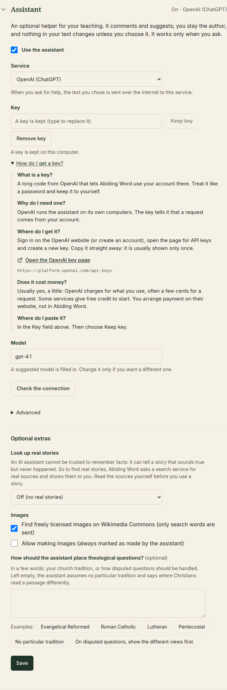

# ⚙️ 8. Settings, updates and backups

[← Concordance](07-concordance.md) · [Contents](README.md) · Next: [Questions and word list →](09-questions-and-word-list.md)

---

Click the **gear** ⚙️ at the top right to open **Settings**. **Back to
workspace** stays at the top while you scroll (or press **Escape**).

<p align="center">
  
</p>

Settings is a short list. Each section is **one line**: its name and where
things stand (for example *Updates · Up to date* or *Assistant · Off*). Click
a line, or press **Enter** or **Space** on it, to open or close that section;
the others stay as they are. The row of names at the top jumps straight to a
section and opens it. Abiding Word remembers which sections you left open.

The sections, in order: **Updates**, **Appearance**, **Bible texts**,
**Templates**, **Language**, **Assistant**, **About this installation** and
**Coming in later versions**.

## Updates

<p align="center">
  
</p>

Normally Updates is a single line: *Up to date*, or your version. It opens by
itself only when there is something to do: an update is available, it is
being installed, or something went wrong.

Every now and then, Abiding Word quietly checks whether a newer test version
exists. If there is one, a slim notice appears under the app bar:

> *An update is available: version …* **Update now** · **Later**

- **Update now** downloads it. The installer closes Abiding Word, installs
  the new version and starts it again.
- **Later** hides the notice for that version.
- **Settings → Updates → Check for updates** looks straight away.

> [!NOTE]
> Abiding Word **never needs the internet** to work. Without a connection,
> there is simply no update notice. Updates don't touch your studies or
> library.

## Appearance

| Theme | Looks like |
|---|---|
| **Light** | Warm ivory, for daytime study |
| **Dark** | Deep forest green, easier in low light |
| **Match my computer** | Follows your Windows setting |

<p align="center">
  
</p>

**Workspace layout → Reset layout** puts the three panes back in their usual
order and size. Your studies and library are not touched.

## Bible texts

<p align="center">
  
</p>

- **Add a Bible…** adds one of the free Bibles included with Abiding Word
  (English, German, Korean, French, Spanish, Portuguese) or a Bible file you own (see
  [Getting started](01-getting-started.md#add-a-bible)).
- **Details** shows a Bible's publisher, licence and contents.
- **Remove…** removes a Bible. Your notes and highlights are kept with their
  verses.

## Templates

Templates are the ready-made section lists a new study starts with. The
built-in ones can't be changed, but you can **duplicate** one and adjust the
copy: rename sections, add hints, change the order.

## Language

Choose the language of menus and buttons: **English, Deutsch, 한국어,
Français, Español or Português**. The change is immediate. Your studies,
notes and Bibles stay exactly as they are.

<p align="center">
  
</p>

## Assistant

The assistant helps when you [prepare to teach](10-teaching.md). It is
**off** until you tick **Use the assistant**; until then this section only
says *Turn on the assistant to choose a service and check the connection.*

<p align="center">
  
</p>

Once it is on, set it up from top to bottom:

1. **Service.** Choose one.
   - *On the internet:* Anthropic (Claude), DeepSeek, Google Gemini,
     OpenAI (ChatGPT), Perplexity, Qwen (Alibaba Cloud) or xAI (Grok). Your
     text is sent to that company when you ask, and you need a **key** from
     it.
   - *On this computer:* **Ollama** or **LM Studio**. These are free programs
     that run an AI model on your own computer: no key, no account, and your
     text never leaves the computer. Install the program, download a model in
     it and leave it running. **How do I set up …?** explains this and opens
     the program's website.
   - *Other compatible service:* for anything else that works the same way.
     Enter the address its instructions give.
2. **Key** (services on the internet). Paste it and click **Keep key**. It is
   kept in your computer's own password store (on Windows: the *Credential
   Manager*), never in your studies, and is not shown again. **Remove key**
   deletes it. Not sure what a key is? Open **How do I get a key?**: what it
   is, why it is needed, where to get it (with a button to the company's own
   page), whether it costs money (usually a little, paid on their website)
   and where to paste it.
3. **Model.** A suggested model is filled in. Change it only if you want a
   different one.
4. **Check the connection.** The button sits right under the model. If it
   cannot be used yet, the reason is written beside it, for example *first
   paste your key and choose Keep key*. When it works: *Connected. The
   assistant answered and is ready.*

**Advanced** holds the service's address. You need it only for a different
server, or for Ollama or LM Studio running on another computer.

**Optional extras**

- **Look up real stories.** An AI assistant cannot be trusted to remember
  facts: it can tell a story that sounds true but never happened. So for real
  stories Abiding Word asks a **search service** for real sources and shows
  them to you: *Brave Search* (needs its own key) or a *SearXNG* address you
  trust. Read the sources yourself before you use a story. Without a search
  service, the assistant says it cannot look up real stories; it never makes
  one up.
- **Images.** Finding freely licensed images on Wikimedia Commons is on (only
  search words are sent). **Allow making images** works with OpenAI or another
  compatible service; such images are always marked as made by the assistant.
- **How should the assistant place theological questions?** (optional). In a
  few words: your church tradition, or how disputed questions should be
  handled. The examples (*Evangelical Reformed*, *Roman Catholic*,
  *Lutheran*, *Pentecostal*, *No particular tradition*, *On disputed
  questions, show the different views first.*) fill it in with one click.
  Left empty, the assistant assumes no particular tradition and says where
  Christians read a passage differently.

Click **Save** for the extras. (Turning the assistant on or off, keeping a
key and checking the connection save by themselves.)

## About this installation

This shows the version and the **folder where your work is kept**. You need
it for backups.

## Backups

Your studies, notes, library and Bibles all live in **one folder**:

```
C:\Users\<your name>\AppData\Roaming\Abiding Word
```

**To make a backup:**

1. **Close Abiding Word.**
2. Copy the whole **Abiding Word** folder to a USB stick, an external drive
   or a cloud folder of your choice.

**To restore it**, close Abiding Word and copy the folder back to the same
place.

> [!TIP]
> Abiding Word also protects you automatically. Before an update changes how
> your data is stored, it saves a copy in the folder's **backups** subfolder.
> If anything goes wrong, nothing is changed and you are told in plain words.

> [!TIP]
> To find the folder quickly, press **Windows key + R**, type `%APPDATA%`,
> press **Enter** and open **Abiding Word**.

---

[← Concordance](07-concordance.md) · [Contents](README.md) · Next: [Questions and word list →](09-questions-and-word-list.md)
