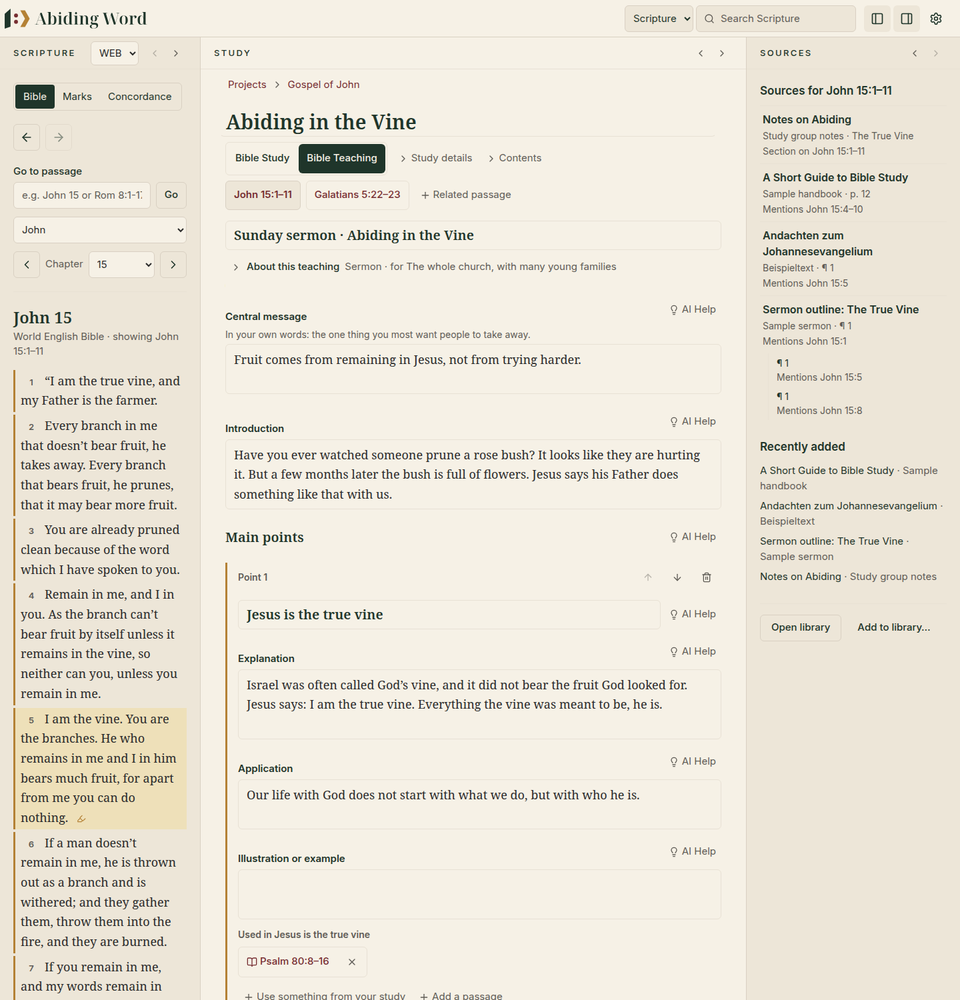
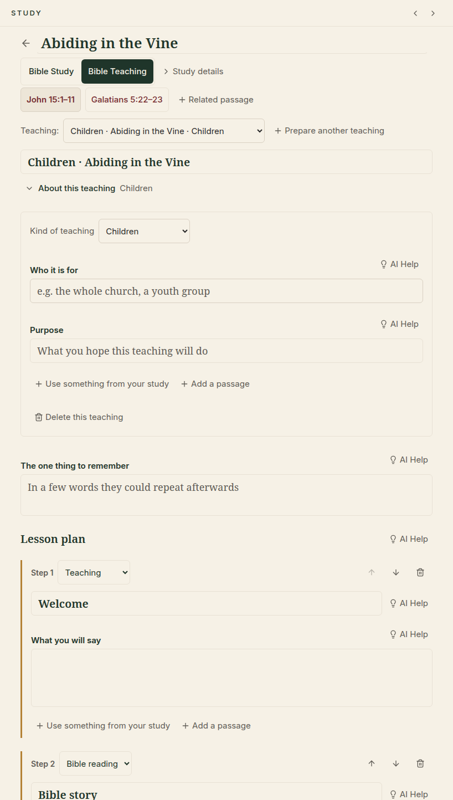
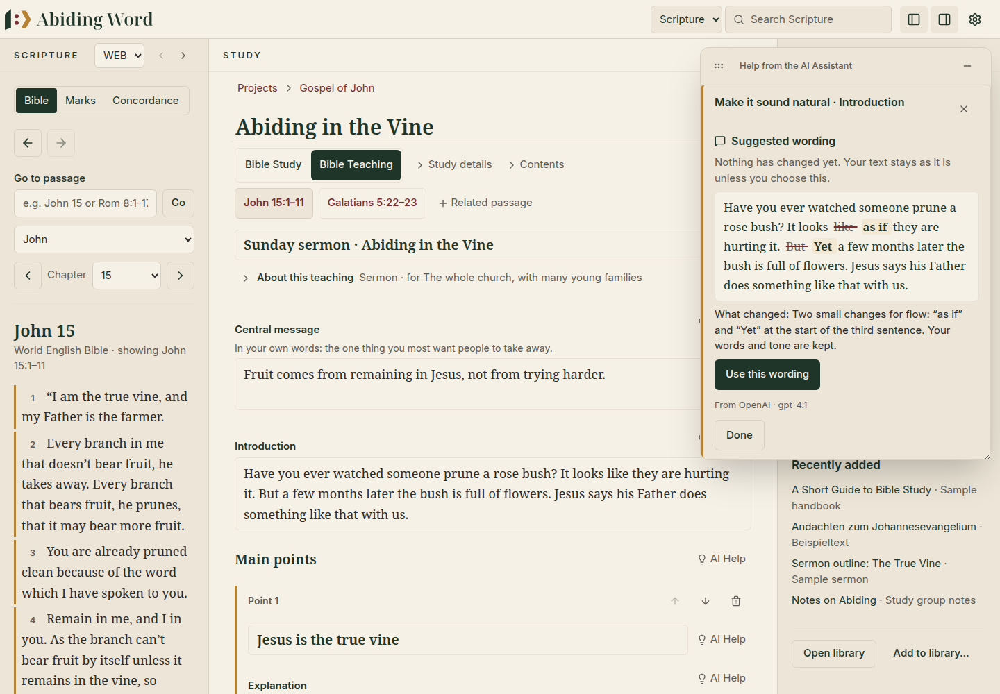
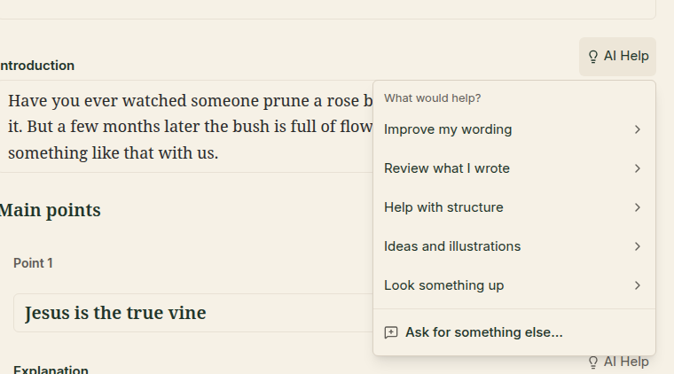

# 🎤 10. Preparing to teach

[← Questions and word list](09-questions-and-word-list.md) · [Contents](README.md)

---

When your study is ready to be shared, Abiding Word helps you **prepare the
teaching itself**: a sermon, a small-group Bible study, a lesson for young
people or children, a talk. **You write it.** The program keeps your study
close at hand, and, only if you want, an **assistant** can give you a second
pair of eyes.

  

A **Bible study** asks *what does this text mean?* A **Bible teaching** asks
*how will I communicate it?* A teaching is always prepared from a study, so
your notes, passages and sources are at hand without being copied.

## Starting

1. Open your study. (Or, on the new-study form, choose **Teaching
   preparation**: Abiding Word makes a passage study and opens its Bible
   Teaching side.)
2. Under the study's title, click **Bible Teaching** (click **Bible Study**
   to go back).
3. Under **What would you like to prepare?**, choose *Sermon*, *Group Bible
   study*, *Youth*, *Children*, *Lesson*, *Talk* or *Other*. If you have
   templates of your own for that kind, **Start from** lets you pick one of
   them or the built-in one (see below). A line under the choices says what it
   gives you to work in, and what it starts with.
4. Change the title if you like, and click **Start**.

Nothing is written for you. A lesson starts with a few empty steps (for
children: *Welcome, Bible story, Question, Activity, Prayer*); the other kinds
start empty.

These starting shapes are only a beginning, not a method you must follow. A
sermon or talk has an introduction and a conclusion with as many main points
between them as you add; a group study starts with no questions rather than
an empty one to delete; the children's *Bible story* is a Bible-reading step.

### Your own templates

If you often prepare the same shape of teaching (a youth evening that always
starts with a game, say), make it a **template**: in **About this teaching**,
click **Save as my template**, give it a name and save. The template keeps
the kind of teaching and its points, questions or steps in order. A lesson's
steps keep their titles and kinds. A sermon's points and a group study's
questions start without titles, because they are the teaching itself. Nothing
you wrote comes with it.

You can also make one in **Settings → Templates → Bible Teaching**: **New
Bible Teaching template…**, or **Save as my template** beside a built-in
one. A new teaching takes a copy of its template, so changing or deleting a
template never changes a teaching.

One study can lead to **several teachings**, for example a Sunday sermon, a
group Bible study and a children's lesson. On the quiet line under the
teaching's title, click **+ Prepare another Bible Teaching**, choose its kind
and click **Start**. Each teaching is its own: nothing in the study or in your
other teachings changes. Once there is more than one, switch between them with
**Teaching:** on the same line.

## A canvas for each kind of teaching

Your writing comes first. The details sit on one quiet line under the title,
**About this teaching** (for example *Sermon · for families · Luke 19:1–10*):
open right after you start, folded when you come back. It holds the *kind*,
**who it is for**, the **purpose**, what the whole teaching uses from your
study, and **Delete this teaching**.

The main canvas follows the kind of teaching:

| Kind | Around the main part | The main part | Each item has |
|---|---|---|---|
| **Sermon**, Youth, Talk, Other | Central message · Introduction · Conclusion | **Main points** | a title, an explanation, an application, an illustration or example |
| **Group Bible study** | What the group should discover · Opening · Closing | **Questions and answers** | the question, where it may lead, follow-up questions, notes for leading |
| **Children**, Lesson | The one thing to remember | **Lesson plan**: steps in order | a kind of step and what that kind needs (see below) |

  

In a lesson, each **step** says what kind of step it is, and shows the fields
that kind needs:

| Kind of step | You write |
|---|---|
| **Teaching** | what you will say |
| **Bible reading** | how you will read or tell it (add the passage with *Scripture*) |
| **Question** | the question, and the answers to listen for |
| **Activity** | how it works, and what you need |
| **Picture** | what it shows and when you show it (find or make the picture with the assistant) |

**Notes for yourself** (reminders while you teach) are at the end of every
kind. Changing the kind of a teaching, or of a step, never loses anything:
a field with writing in it is always shown.

In a lesson, **Add a step** asks which kind of step to add: *Teaching*,
*Bible reading*, *Question*, *Activity* or *Picture*.

Everything is **saved as you type**. Move an item with the ▲ ▼ buttons
beside it; delete it with 🗑 (if you wrote in it, you are asked first).

## Using your study

- **Use something from your study** puts one of your study's notes (an
  observation, a question, an insight…) under the whole teaching or under an
  item. It stays in your study: if you change it there, it changes here too,
  and **Stop using this here** (✕) never deletes it. A note you made from a
  book still shows its quotation and opens the book at those words.
- **Add a passage** names a Bible passage for the whole teaching or for one
  item. Click it to open it in the Bible. It is not added to your study's
  own passages.

## Materials: what your teaching becomes

Click **Materials** next to the teaching's title to see what you can prepare
from it. What is offered depends on the kind of teaching:

| Kind of teaching | Materials |
|---|---|
| Sermon, talk, youth, other | **Presentation**, **Manuscript** (the whole teaching as one text to preach from), **Listening notes** (the points with room to write, to hand out) |
| Group Bible study | **Presentation**, **Leader’s guide** (the questions with where each may lead), **Question sheet** (the questions for the group) |
| Lesson, children | **Presentation**, **Teacher’s guide** (the lesson step by step), **Worksheet** (its questions and activities with room to write or draw) |

Each one opens straight away as the page it will be. It is put together from
what you wrote in the teaching, in its order, word for word: nothing is written
for you, and a part you left empty is simply left out. To change it, change the
teaching; it changes here too. Opening a material never changes your teaching.

- **Print or save as PDF…** opens the print dialog. Only the material is
  printed; choose *Save as PDF* (or *Microsoft Print to PDF*) there to keep a file.
- **Save as a Word document…** saves it as a .docx file to open and change in
  Word or LibreOffice: real headings, paragraphs and numbered questions, with
  lines to write on.
- **Save as a text file…** saves it as Markdown, a plain text file any editor opens.
- **Copy the text** puts it on the clipboard for a document or an email.

A few plain choices sit beside it. **My notes for myself** adds your notes to the
manuscript; they are never put on a sheet for others. A question sheet is for
the group: only the title, the passage and the questions. Your notes on where a
question may lead, follow-up questions and notes for leading are on it only when
you tick **Leader’s version**, which then says at the top that it is not for
handing out. **“Opening” and “Closing”** adds those to the group's sheet.

**Include Bible passage** puts the text of the teaching's passage on the
material, from the Bible you chose in the Scripture pane (its name is on the
choice). It never takes words from another Bible. If that Bible has no text
for a verse, the material says which verse, and keeps the reference. The text
stays on your computer: it goes only into the material you make.

Once you have made slides, **Save the presentation as a file…** is also in
Materials: the same PowerPoint, PDF, speaker sheet, Markdown and delivery
package as in the presentation itself.

## The assistant (optional)

The AI Assistant is **off** until you turn it on in **Settings → AI
Assistant** (see [Settings](08-settings-updates-backups.md#ai-assistant)).
When it is on, each part of your teaching has a small **💡 AI Help** button
(*Help from the AI Assistant*).

  

> [!IMPORTANT]
> **You are the author.** The assistant never writes your teaching for you
> and never changes your text by itself. It suggests; you decide.

### What you can ask

**💡 AI Help** opens a short menu. Choose a category, then what you want
(arrow keys move, **Enter** or **→** opens a category, **←** or **Escape**
goes back, **Escape** again closes the menu):

  

| Category | Ask for… |
|---|---|
| **Improve my wording** | Check grammar and spelling · Make it clearer · Make it shorter · Make it sound natural · Remove repetition · Easier to say aloud · Adapt for an audience · Translate |
| **Review what I wrote** | Review what I wrote · Does the application follow from the passage? · Check theology and the passage |
| **Help with structure** | Help with a transition (beside the main part: comment on the structure, or how you could order what you have) |
| **Ideas and illustrations** | Other ways to say this · Help with a discussion question · Ideas for an illustration · Suggest a visual |
| **Look something up** | Suggest passages to look at · Find a real story |
| **Ask for something else…** | anything else, in your own words (see below) |

Short parts (who it is for, purpose, titles) offer fewer choices.

**Ask for something else…** lets you write what you need, for example *Is
this too long for a youth group?* The assistant sees this part and what it
needs from this teaching and study, and answers with **comments and
questions only**. It does not write your teaching for you, even if asked;
there is nothing to paste into your text.

### How it works

1. Click **AI Help** beside a part and choose what you want. The AI
   Assistant opens in its own **panel over the workspace**, at the upper
   right: your text does not move, and you can keep reading and writing
   while it is open. Drag its top bar to move it (or use the arrow keys on
   its move button), drag its lower corner to make it bigger or smaller, and
   use **–** to shrink it to a small *AI Help* chip at the bottom right
   (click it to bring the panel back, with your request kept). Only one panel
   is open at a time: asking about another part, or asking again, starts a
   new request there.
   *Tip:* select a few words first to work on just those.
2. The assistant says **what will be shared and where it goes**, for example
   "To help, this will be sent to OpenAI: your Introduction; your central
   message; Scripture: John 15:1–8; 2 notes from your study". With a
   program on your own computer it says "This stays on this computer".
   **Nothing is sent until you click Ask** (or press Ctrl+Enter).
3. You see the answer **apart from your text**:
   - **Suggested wording** shows exactly what would change (struck-through
     words are removed, underlined words added). Your text stays as it is
     unless you click **Use this wording**, and **Undo** brings your earlier
     text back.
   - **Comments** say what the assistant says they draw on: Scripture, your
     study, a book in your library, or *the assistant's own thought, to weigh
     for yourself*.
     A suggested passage is added to your teaching only if you click **Add**.
   - **Illustration ideas** are always marked **invented examples, not real
     events**. Do not tell them as if they happened.
4. Press **Escape** or click **Done** to close it; the cursor goes back to
   the **AI Help** button you used. Nothing has changed unless you chose it.

While the assistant works you see it at once, in words: *Asking the
assistant…*, *Looking for sources… This can take a little while.*, *Finding
suitable images…* or *Creating an image… This can take a little while.* The
button cannot be pressed twice. If it takes long, it says so, and **Stop
waiting** lets you go on (nothing is changed; the service may still finish
the request, and it may count toward your use). If the service does not
answer, you are told plainly and can try again.

If a part is still empty, the assistant does not fill it: *"Write something
here first. The assistant helps with what you have written."*

### Real stories

**Find a real story…** looks for real stories, events or examples. Describe
in a few words what you are looking for (e.g. *forgiveness after a conflict*).

- This only works with a **search service** set up in Settings (**Look up
  real stories**: Brave Search, Tavily or Exa, or SearXNG or SerpApi). An AI assistant cannot be trusted to remember facts, so the
  stories come from real sources the search finds. Without a search service,
  the assistant tells you it cannot look up real stories; it does not make
  one up.
- Each story shows **where it came from** (click a source to open it in your
  browser) and what the search found:
  - *Sources found: two independent sites in the search results report it.
    Source quality varies, so read them before you use it*, or
  - *Needs checking: only one source was found. Read it before you use it.*
- A search finds pages; it never makes a story true. Abiding Word does not
  call a story "true", only supported by sources or in need of checking.
- Always read the sources yourself before you use a story.
- **Keep with this teaching** stores the story with its sources under the
  part you asked about.

### Pictures

**Suggest a visual** gives ideas for a photo, a simple diagram or a drawing.
For each idea you can:

- **Find freely licensed images** (from Wikimedia Commons): each shows its
  licence and author, and **Where it is from**.
- **Make an image**, if you turned this on in Settings and your AI service
  can make images: always marked *Made by the assistant: an illustration,
  not a photograph*. If your service cannot (Claude, DeepSeek and others are
  text-only), the button is greyed out and says why; you can choose OpenAI
  for images in Settings. Finding freely licensed images still works.
- **Keep** an idea or an image. Nothing is placed in your teaching unless you
  keep it.

Kept stories, ideas and images appear under the part they belong to, with a
dashed border and their label, so they never look like your own writing.

## Your privacy

- The assistant is optional. Abiding Word works fully without it.
- It acts only when you click **Ask**, never while you type.
- It sees only the part you asked about and what it needs from **this**
  teaching and **this** study (listed before you ask), never your other
  studies, your whole library or your other teachings.
- Your key is kept in your computer's own password store, not in your
  studies.

---

[← Questions and word list](09-questions-and-word-list.md) · [Contents](README.md) · [Presenting your teaching →](11-presenting.md)
