# 📽️ 11. Presenting your teaching

[← Preparing to teach](10-teaching.md) · [Contents](README.md)

---

When your teaching is written, Abiding Word helps you **deliver it**: slides
for your audience, a **Presenter View** for you, and files to take along —
PowerPoint, PDF, a speaker sheet for your phone.

A presentation is not something new to write. It is **made from your
teaching** and keeps following it: change a point in the teaching and its
slide changes too. You only choose what your audience sees, in which order,
and what only you see.

  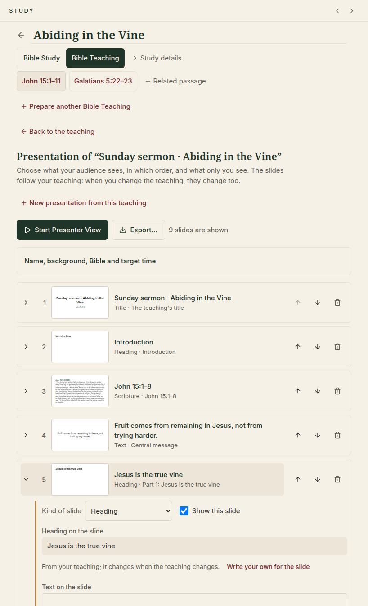

## Making the slides

1. Open your Bible Teaching, click **Materials** (on the right, next to the
   teaching's title) and choose **Presentation**. *Materials* gathers what a
   teaching becomes: its presentation, and a manuscript and sheets to print
   ([Preparing to teach](10-teaching.md#materials-what-your-teaching-becomes)).
2. Click **Make slides from the teaching**. Abiding Word puts the teaching's
   title, its passages, the central message, each point or step, its questions
   and the images you kept into slides, in the teaching's order. This is done
   by fixed rules on your computer; no assistant is used.
3. Look through the slides. Click a slide to open it:
   - **Heading** and **Text on the slide** come from your teaching. To word
     them differently for the audience, click **Write your own for the
     slide**. Your teaching stays as it is; **Use the teaching's words again**
     brings back the teaching's wording.
   - **Speaker notes** are for you only. They appear in the Presenter View and
     the speaker sheet, **never on the audience screen**.
   - Untick **Show this slide** to leave it out (it stays in the list).
   - To change the order, **drag a slide by its handle** (⋮⋮ on the left) to
     its new place — a line shows where it will land, and the list scrolls
     when you reach its edge. **Esc** cancels a drag. Without a mouse, use
     the **Move earlier / Move later** arrows; the bin removes a slide.
     Moving slides changes only the presentation, never your teaching.
4. **Add a slide**: one of the teaching's parts not shown yet, or your own:
   a heading, text, Scripture, a question, an activity, a quotation, a
   section break, a **Pause** (an empty screen for the audience) or a title.

Under **Name, design, Bible and target time** you choose the **design** —
a built-in background (*Light*, *Dark* or *Warm*) or one of your church's
templates (see below) — which installed Bible the Scripture slides quote,
and — if you like — a **target time** (for example 30 min). You can
make several presentations of one teaching, for example a short and a long
one.

> [!NOTE]
> Your introduction and conclusion are things you *say*. Their slides show a
> heading for the audience; the text itself is in your notes.

## The Presenter View

Click **Start Presenter View**. It adapts to your screen:

| On a computer | On a tablet-sized window | On a phone-sized window |
|---|---|---|
| 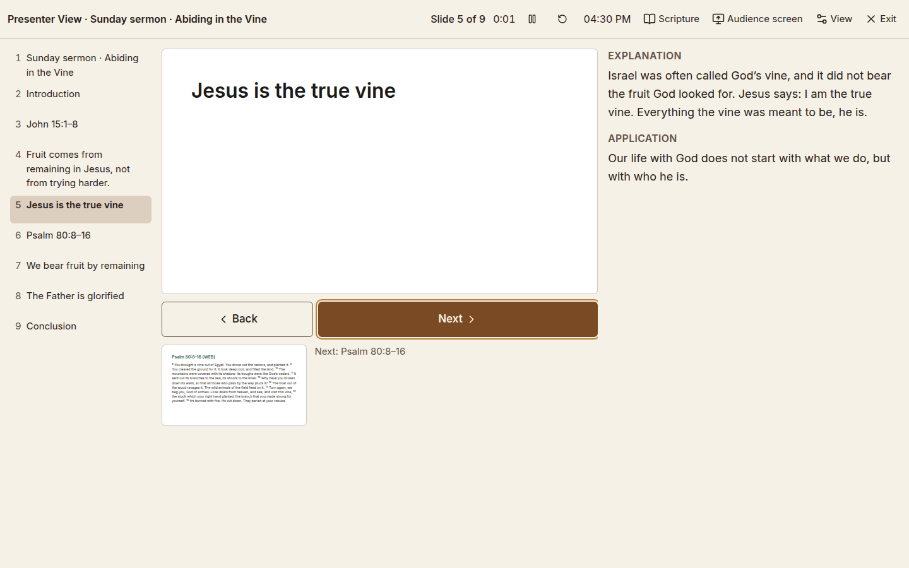 | 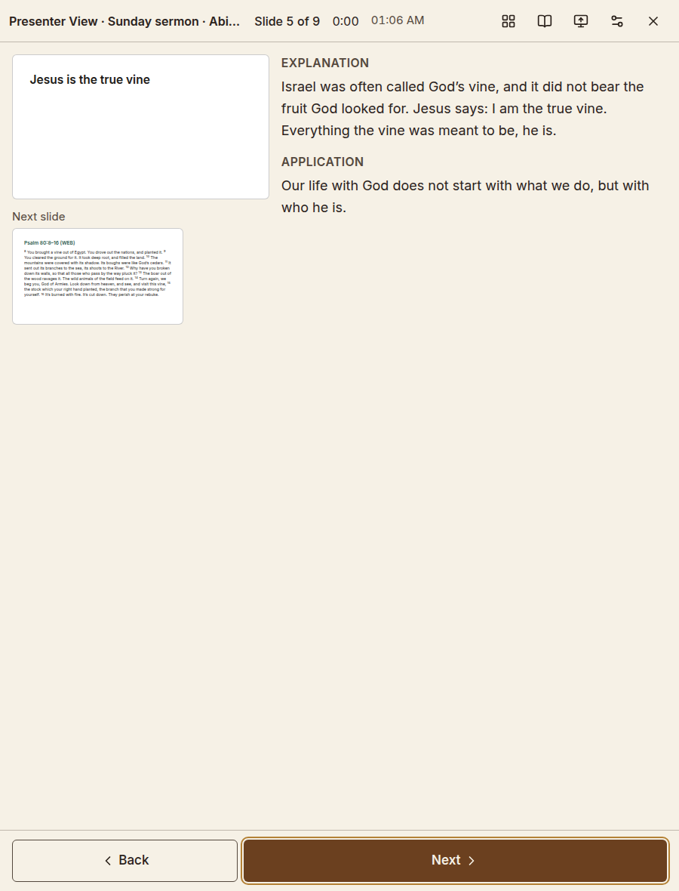 | 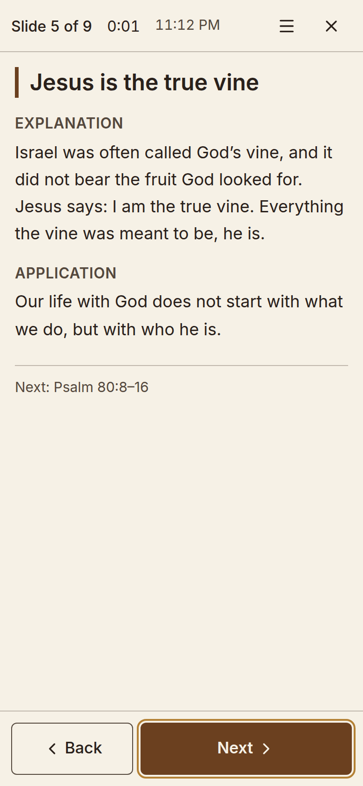 |

- **Next** and **Back**, or the keys **→ / Page Down / Space** and **← /
  Page Up**. A presentation clicker works without any setup.
- **Overview** (or the key **O**) shows all slides at once: click one to go
  straight to it. You can also type a slide's number and press **Enter**.
- The **timer** starts when you begin — with your first move to another
  slide, or when you show the audience screen — so it does not count the
  songs before you speak. Click it to pause, reset or start it by hand. With a target time it quietly adds how much is left ("· 18 min left"),
  and only near the end or after it does it change colour. The **clock**
  shows the time of day.
- **View**: the **Layout** (*Slides and notes*, *Larger notes* or *Larger
  slides* — remembered on this computer; a phone always shows the large-print
  sheet), larger or smaller text, your background (*Follow app*, *Light*,
  *Dark* or *Warm* — see below),
  timer and clock on or off, **Keep the screen on** (where your computer
  allows it; otherwise it says so) and the keyboard shortcuts.
- Overview, Bible passage, Audience screen and View open **over** the view
  (on a phone, from the ☰ menu): your notes never move. **Esc** closes what is
  open, one thing at a time; with nothing open it leaves the Presenter View
  (while the audience screen is on, press it twice, so a stray key on a
  clicker cannot end your talk).
- When the audience sees something other than the slide (a blank screen or
  a passage), a small note beside the title says so, with **Return to
  slide**.
- Nothing can be edited here, so nothing changes by accident.

  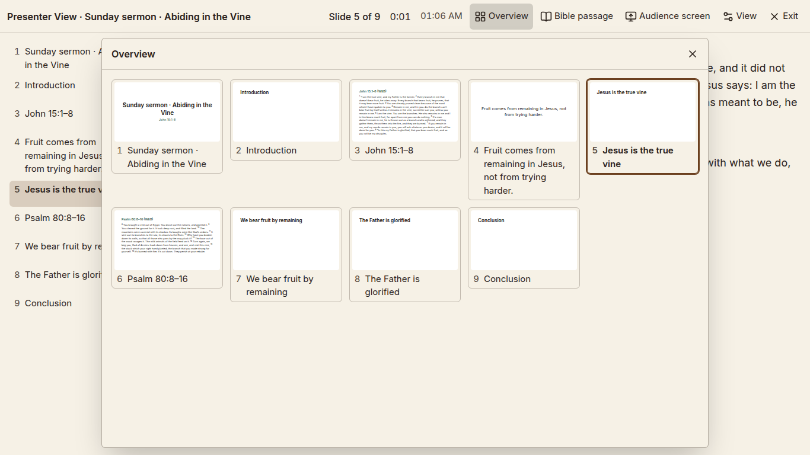

  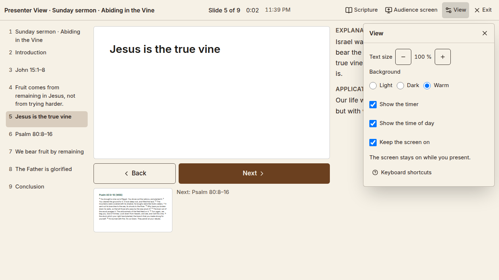

### Your background in the Presenter View

The Presenter View starts with **Follow app**: it looks like the rest of
Abiding Word — light or dark as your theme is (or as Windows is, with *Match
my computer*), in your chosen background. Dark theme with *Sage* gives a dark
sage reading surface. If Windows switches to dark while you speak, the
Presenter View follows at once.

Choose *Light*, *Dark* or *Warm* under **View** to keep the Presenter View
that way whatever the app does. That choice is remembered on this computer
and changes only the Presenter View — never the rest of the app, and never
what the audience sees: their slides keep the presentation's own design or
your church's template.

### The audience screen

Click **Audience screen** (on a phone: ☰ → **Audience screen**):

- With a projector or second screen connected, choose **Show on screen 2**.
  The slides fill that screen and follow you; you keep your notes on yours.
- With one screen (or a mirrored one), choose **Show in this window**. The
  slides fill this window; **Esc** brings you back to your notes.

The audience sees **only the slides**: never your notes, your manuscript or
where your stories came from.

While the audience screen is on:

- **Blank audience screen** (beside Back and Next, or the key **B**) makes
  their screen blank for a moment — you keep your notes and your place.
  Press it again to bring back the same slide.
- Over your current slide are the **Pointer** (a soft red spot the audience
  sees), the **Highlighter** (to mark a word in a verse) and **Clear marks**.
  Marks are only for the moment: they disappear with the next slide and are
  never saved. **Esc** puts the pointer or highlighter away.
- If the audience screen is closed by accident or the projector is unplugged,
  your Presenter View simply stays where you are and says **Audience screen
  disconnected**. Click **Show again**.

  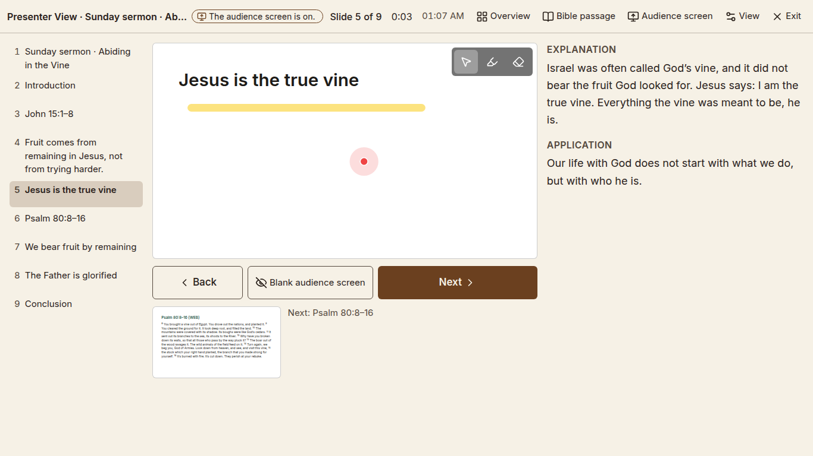

  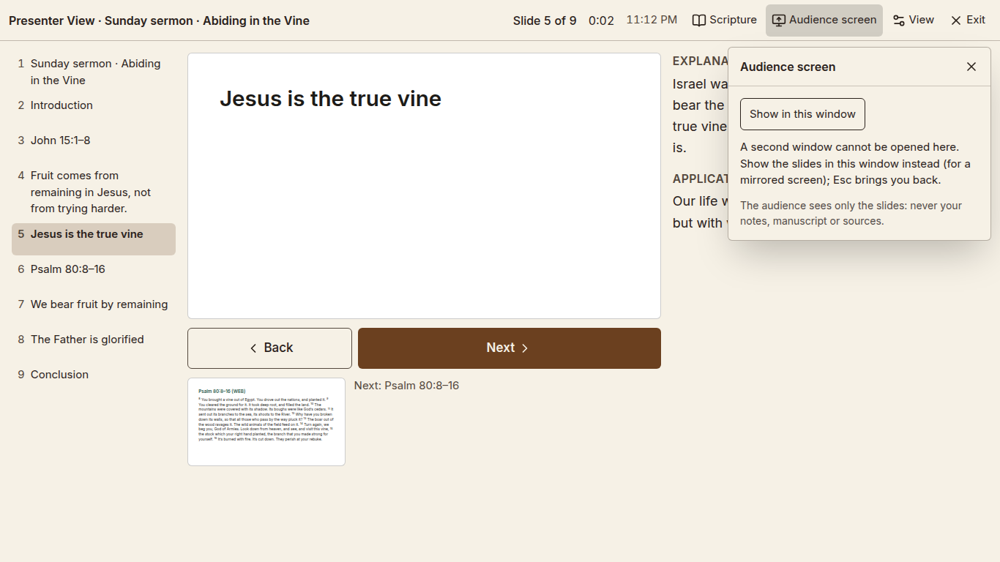

  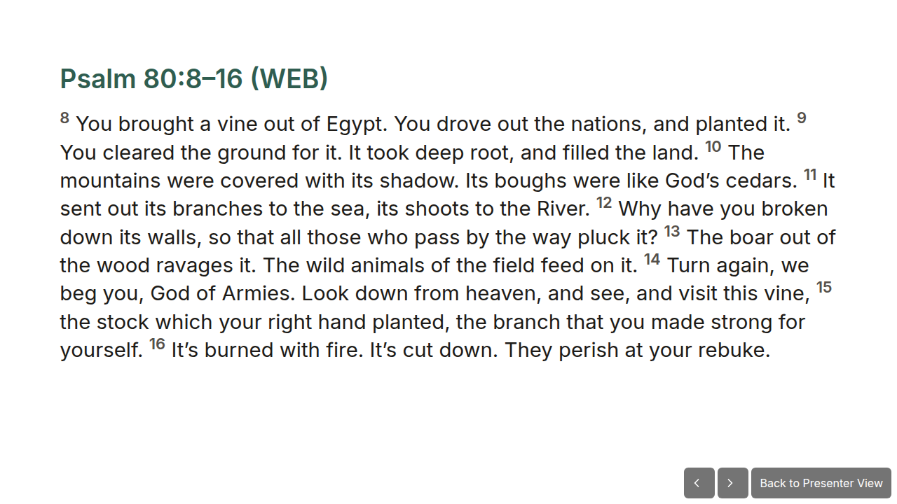

### A Bible passage without losing your place

Click **Bible passage** to look up any passage (or one of the presentation's
passages). Type it the way you would write it, in any language — *John 15:5*,
*Joh 15,5*, *Johannes 15,5*, *Jean 15,5*, *요한복음 15장 5절*, *Иоанна 15:5* or
*约翰福音 15:5* all find the same passage, whatever language Abiding Word is
in (see [Bible references](06-bible-references.md#typing-a-passage-in-any-language)). You read it privately; click **Show to audience** to put it on
their screen for a moment, and **Return to slide** (or move on) to go back to
your slide. You never lose your place, and your presentation is not changed.

  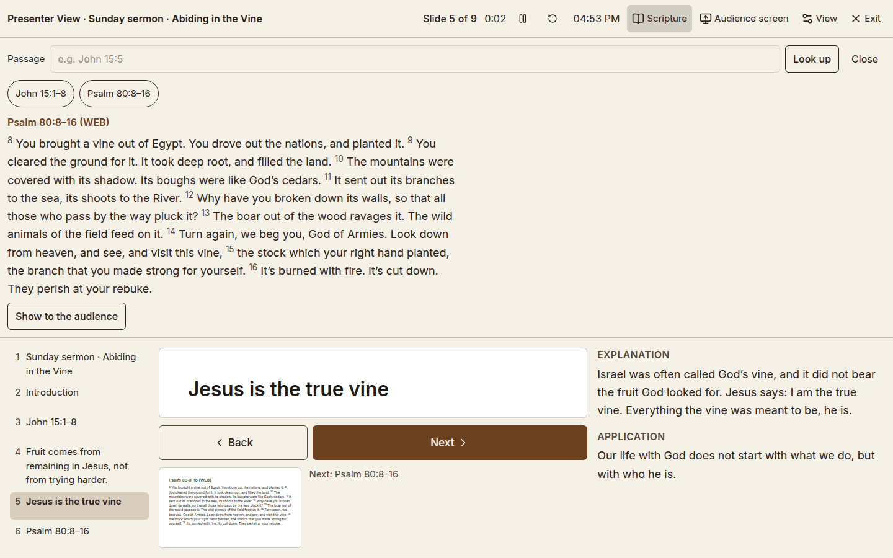

## Your church's slide design (templates)

Many churches have their own slide design: a background, a logo, fonts and a
special look for Bible verses. You can use it for your presentations.

Under **Name, design, Bible and target time**, click **Manage templates…**.
There you can:

- **Import from PowerPoint…** — choose a PowerPoint file (.pptx) that has
  your church's design. Only the **design** is taken: its slide size,
  colours, fonts, backgrounds, logo, footer and the boxes of its layouts.
  The slides that happen to be in the file are not imported.
- **Add a template file…** — a template saved from Abiding Word on another
  computer (.awtemplate). It brings its pictures along; fonts are never
  copied.
- **New template** — make a simple one here (see below).

> [!TIP]
> **Which files work:**
>
> | Made in | How to bring it in |
> |---|---|
> | **PowerPoint** | Import the .pptx directly. |
> | **LibreOffice Impress** | *File › Save As* → PowerPoint (.pptx), then import that. OpenDocument files (.odp) cannot be imported. |
> | **Keynote** | *File › Export To › PowerPoint*, then import the .pptx. |
> | **Google Slides** | *File › Download › Microsoft PowerPoint (.pptx)*, then import that. |

### Checking an imported design

Before anything is kept, Abiding Word shows you what it found:

  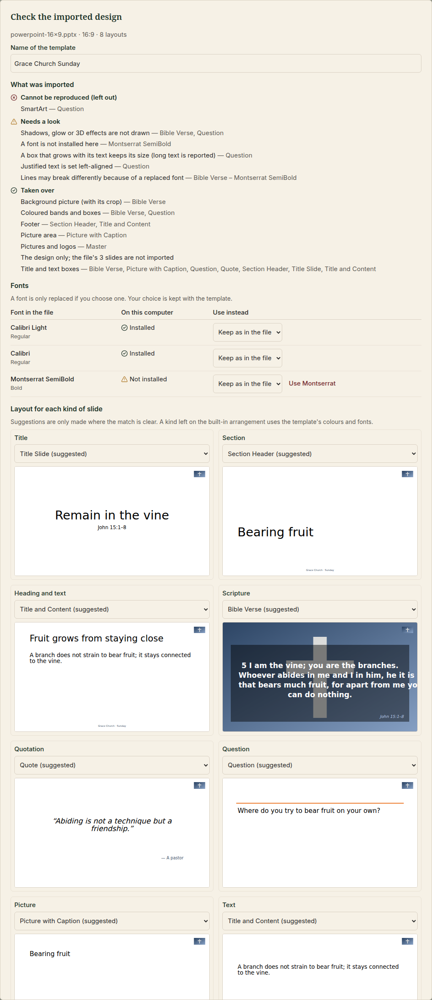

- **What was imported**, in three groups, each with a symbol and words:
  **Taken over**, **Needs a look** (for example a shadow that is not drawn,
  or justified text set left-aligned) and **Cannot be reproduced** (for
  example SmartArt or a table). Nothing is left out without being listed.
- **Fonts**: whether each font is on this computer. A missing font is
  **never replaced by itself**. You can keep it (PowerPoint uses it where it
  is installed) or choose one that is installed — a close match is offered
  with **Use …**. Your choice is kept with the template.
- **Layout for each kind of slide**: which of the file's layouts a title,
  a Scripture slide, a quotation and so on use. Abiding Word only suggests a
  layout where the match is clear (for example a layout called "Bible
  Verse" for Scripture). Any kind can stay on the **Built-in arrangement**,
  which uses the template's colours and fonts.

Click **Keep this template**, or **Cancel** to keep nothing.

### Using a template

Choose the template under **Design**. The slide pictures in the list, the
Presenter View, the audience screen, the PowerPoint file and the PDF all
show the slides in the template — laid out the same way. Choosing a
built-in background again drops the template; your slides and your
teaching are never changed by a template. Your own Presenter View keeps its
usual look; only the audience's slides wear the church design.

If a text is **too long for a template's box**, it is not made smaller
quietly. The slide says **Text too long for the template's box**, a note
above the list counts such slides, and after an export you are told how
many boxes to check. Shorten the text, or let that box shrink in the
template.

  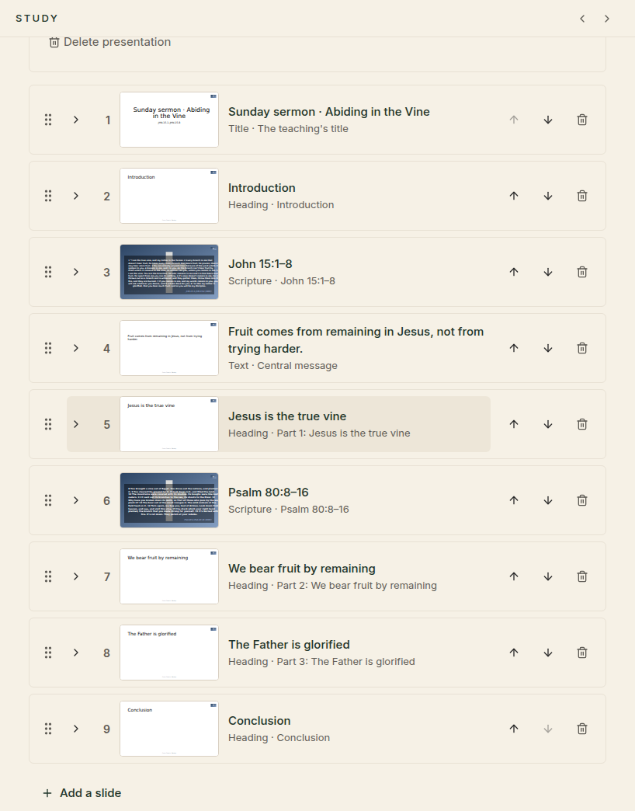

### Making a simple template

**New template** (or **Edit** on one of yours) opens a small designer: a
name, the slide size (16:9 or 4:3), four colours, the fonts for headings and
text, a background picture, a logo and a footer text. For each kind of
slide you can tick **Own layout for this kind** and place its boxes —
*Heading*, *Passage or author* and *Text*:

- drag a box to move it and its corner to resize it, or
- select it and use the **arrow keys** (Shift for bigger steps), or type its
  position and size in points;
- choose its text size, alignment, colour, bold or italic, and whether long
  text may **shrink to fit** (down to a readable size).

  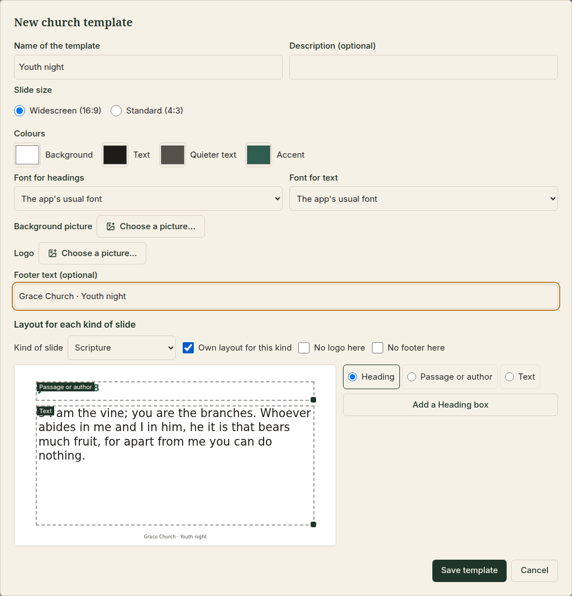

It is deliberately simple: no animations, no slide masters, no drawing
tools. For anything more, design it in PowerPoint and import it.

**Save … as a file** (in Manage templates) writes a template file to take to
another computer; **Delete** removes a template — presentations that used it
simply show their built-in background again.

## Taking it along: export

Click **Export…**, choose a format and **Choose where to save…**:

  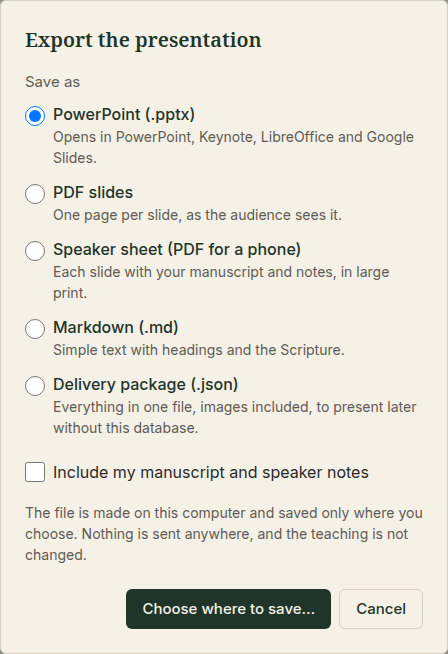

| Format | What you get |
|---|---|
| **PowerPoint (.pptx)** | The same slides (in your church template, if one is chosen), to open in PowerPoint, Keynote, LibreOffice or Google Slides. Tick *Include my manuscript and speaker notes* to have them in the notes pages. |
| **PDF slides** | One page per slide, as the audience sees it. |
| **Speaker sheet (PDF for a phone)** | Each slide with your manuscript and notes in large print — easy to read on a phone. |
| **Markdown (.md)** | Simple text with headings and the Scripture. |
| **Delivery package (.json)** | Everything in one file, images included, to present later without this database. |

The file is made on your computer and saved only where you choose (you are
asked before a file is replaced). Nothing is sent anywhere, and your
teaching is not changed.

## Presenting without the internet

Everything you present comes from your computer: the Scripture from your
installed Bible, generated images you kept, and copies of found images. If a
slide says **This image is not on this computer yet**, click **Save a copy**
once while you are online; afterwards it works offline too.

---

[← Preparing to teach](10-teaching.md) · [Contents](README.md)
