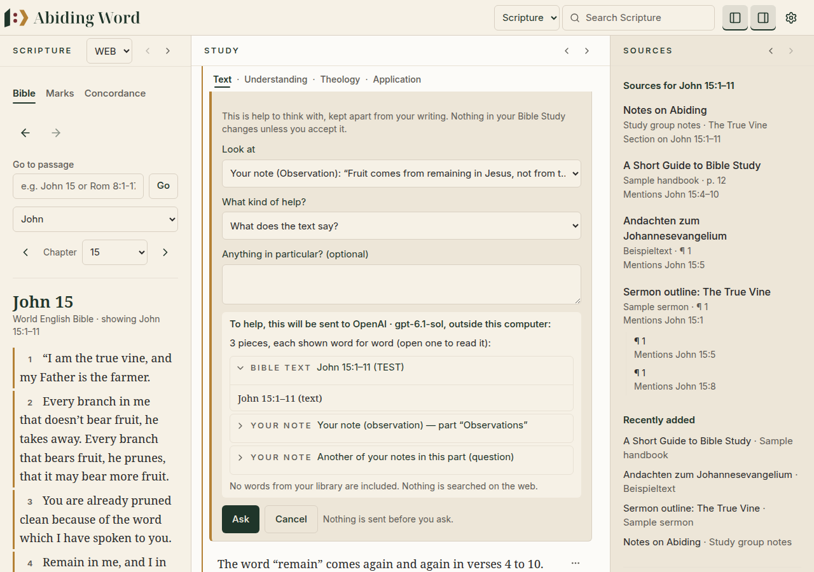
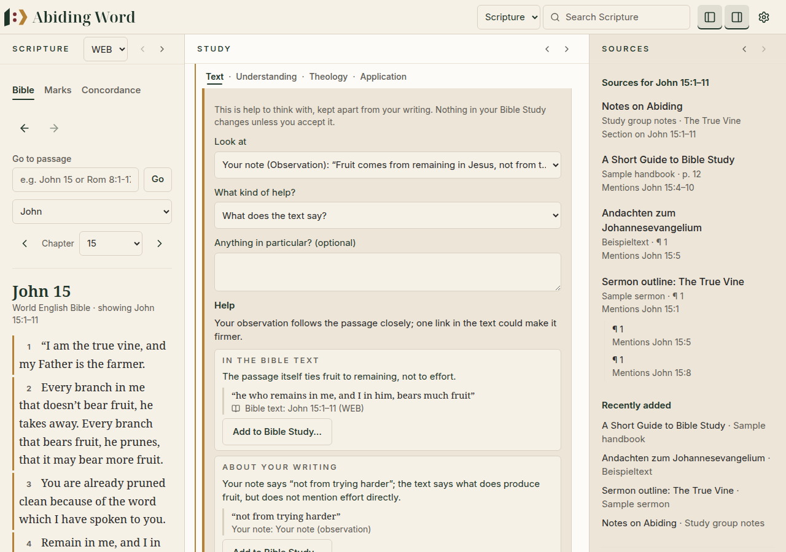
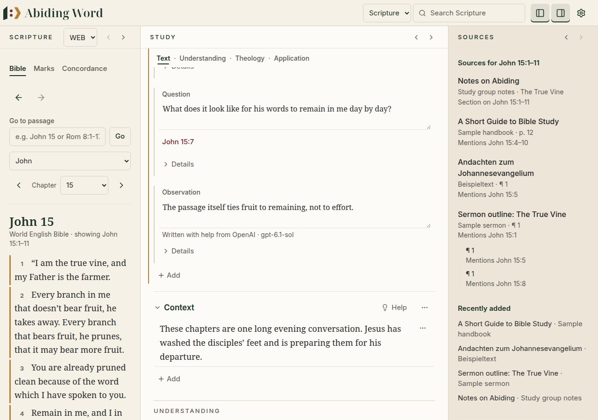
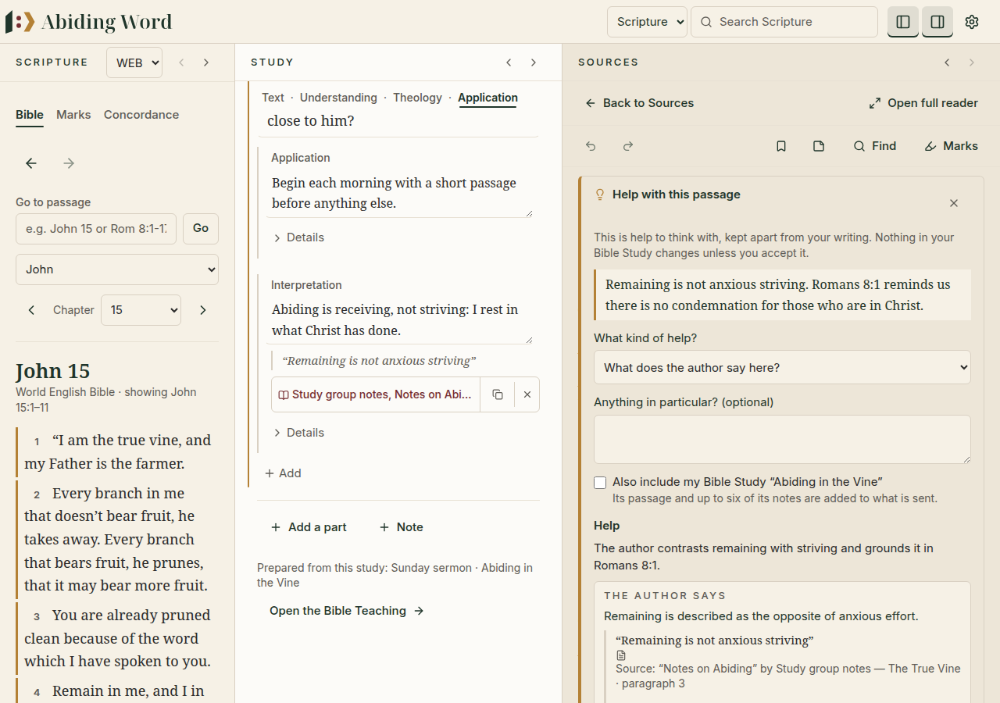
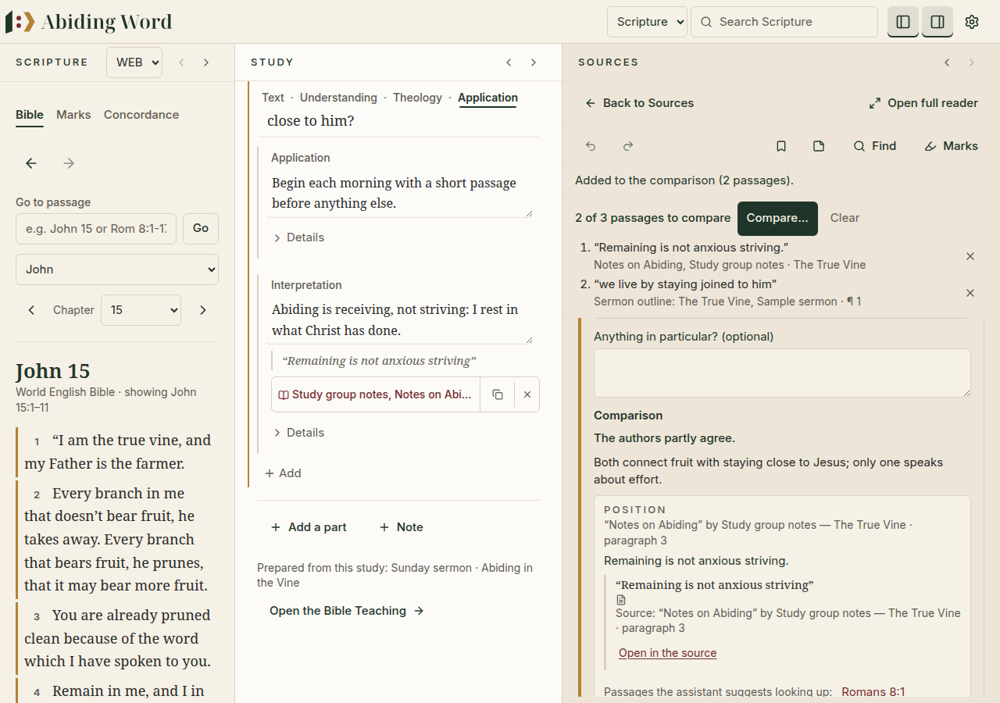

# 💡 12. Help with study and research

[← Presenting your teaching](11-presenting.md) · [Contents](README.md)

---

When the **AI Assistant** is turned on (Settings › AI Assistant), it can also
help while you **study a passage** and while you **read your books**. It is
always your study: the assistant offers observations, questions and
references to think with, kept apart from your writing. Nothing changes in
your Bible Study unless you accept it.

With the assistant off, none of this appears and nothing is ever sent.

## In a Bible Study

Each part of a study has a small **💡 Help** button next to its title.

1. Click **Help**. A panel opens under the part's title.
2. **Look at** — choose what the help is about: all your writing in this
   part, one piece of it, the words you selected (select them first, then
   click Help), or one of the part's notes.
3. **What kind of help?** — for example *What does the text say?*, *Does my
   conclusion follow from the text?*, *What am I assuming?*, *How do
   Christians read this differently?*, *Think through my open question*,
   *Clearer wording*, or *Ask your own question*.
4. Before anything is sent, the panel lists **exactly what will be sent**,
   piece by piece (open a piece to read it word for word), and **where**: to
   a service outside your computer, or to a model on your computer. Nothing
   is searched on the web.
5. Click **Ask**. You can **Stop waiting** at any time.

  

### Reading the answer

Each point says **what it rests on**:

| Label | Meaning |
|---|---|
| *In the Bible text* | shown with the words of the passage, from your Bible |
| *About your writing* | shown with your own words |
| *The author says* | shown with the author's words (library help) |
| *Interpretation* | a reading of the text or of an author |
| *The assistant's reasoning* | its own thinking, not a source |
| *Background knowledge — please check* | something it knows that was not in what you sent |
| *Question* / *Not settled* | for you to think about |

Abiding Word **checks every quotation** against what was sent. A quotation
that is not there is left out, and a point that relied on it is shown as
the assistant's reasoning. Passages the assistant suggests can be opened
with one click.

  

### Using what helps

- **Wording**: a suggestion is shown as changes to your text (removed words
  struck through, new words underlined). **Use this wording** puts it in
  your text; nothing changes until you click it. If you have changed the
  words since asking, nothing is replaced.
- **Add to Bible Study…**: turns a point (or the whole answer) into a note
  in this part. The note's words are prefilled: change anything first. The
  note says *Written with help from …* so you always know.

  

## While reading a book

Select words in a library book, then click **Help** in the bar under them.
Only **those words** are sent, with the book's title, author and place. Tick
**Also include my Bible Study** to add your open study's passage and a few
of its notes.

The answer shows the author's own words; **Open in the source** takes you to
exactly those words. **Add to Bible Study…** keeps a note that cites them,
like *Add to Study* does.

  

A scanned PDF without text cannot be used: the assistant works only from a
book's text.

## Comparing two or three passages

1. Select words in a book, then **More actions → Add to comparison**.
2. Do the same in another passage or another book (up to three).
3. The tray above the text shows the passages. Click **Compare…**, then
   **Ask**.

The comparison gives each author's position with their words and the
Scripture they appeal to, where they agree and disagree, what they assume,
and what the passages do not support. It never makes them agree more than
their words do: *The selected passages do not say enough to compare* is an
honest answer. **Keep this comparison as a note…** adds it to your open
study, citing each passage. Only the passages you chose are used; nothing is
searched.

  

---

[← Presenting your teaching](11-presenting.md) · [Contents](README.md)
