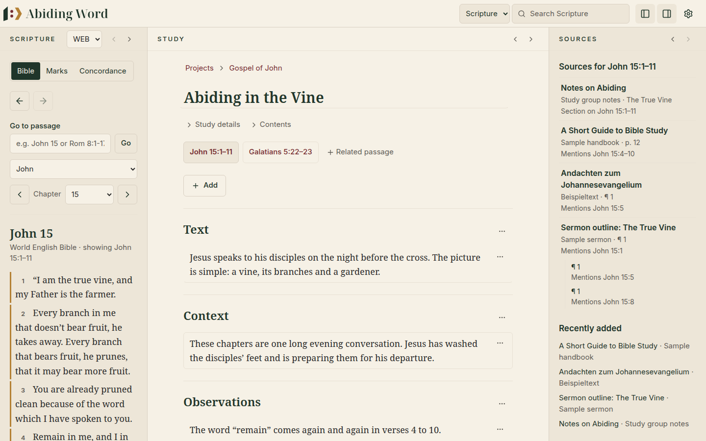

  

<h1 align="center">Abiding Word — User Guide</h1>

<em>Study with diligence. Teach with love.</em>

  

Welcome! This guide explains Abiding Word in everyday language, step by step,
with pictures of the real program. You do not need any technical knowledge.

> [!TIP]
> New here? Read **Getting started** first. It takes about five minutes and
> covers everything you need for your first study.

## Contents

| | Chapter | What you will learn |
|:-:|---|---|
| 🚀 | [**1. Getting started**](01-getting-started.md) | Install the program, add a Bible and find your way around the screen |
| 📖 | [**2. Reading the Bible**](02-reading-the-bible.md) | Move through books and chapters, type a passage, switch translations, search |
| 🖍️ | [**3. Highlights, notes and bookmarks**](03-highlights-notes-bookmarks.md) | Mark verses and words, write notes, find everything again in *Marks* |
| ✍️ | [**4. Studies**](04-studies.md) | Create a study, write in its sections, and collect what you discover |
| 📚 | [**5. Your library**](05-library.md) | Add your own books, notes and documents and read them beside the Bible |
| 🔗 | [**6. Bible references in your books**](06-bible-references.md) | Open a verse mentioned in a book with one click, and find your way back |
| 🔎 | [**7. Concordance**](07-concordance.md) | See every place a word appears in the Bible |
| ⚙️ | [**8. Settings, updates and backups**](08-settings-updates-backups.md) | Theme, language, Bibles, updates, and keeping your work safe |
| ❓ | [**9. Questions and word list**](09-questions-and-word-list.md) | Answers to common questions and a short explanation of the terms used |

## Abiding Word in one minute

Abiding Word is a desktop program for careful Bible study. It follows a simple
path: **read the Word → understand it → teach it**.

- **Everything stays on your computer.** No account, no internet connection,
  no cloud. Your studies belong to you.
- **Three panes side by side:** the Bible on the left, your study in the
  middle, and your own books on the right.
- **Nothing is guessed.** Abiding Word uses no artificial intelligence. When
  it shows that a book mentions John 15:5, it is because the book really says
  "John 15:5".
- **Six languages:** English, Deutsch, 한국어, Français, Español and Português.

> [!NOTE]
> Abiding Word is still being built. The version described here is a
> **test version** (0.5). Some features are marked as *planned* in this guide.
> They are not available yet.
